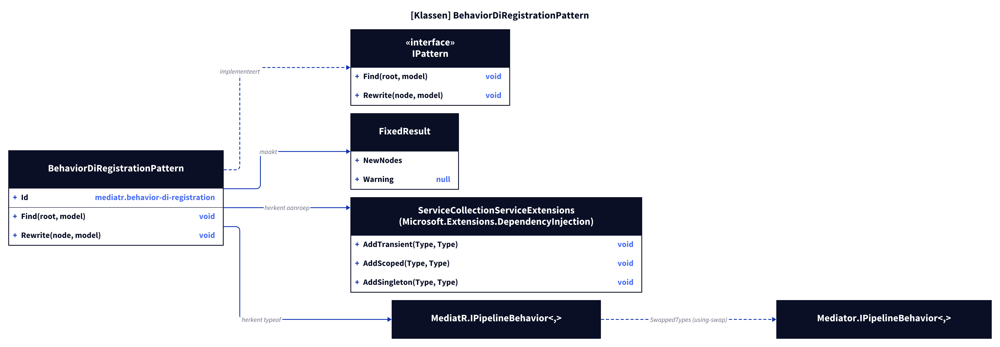
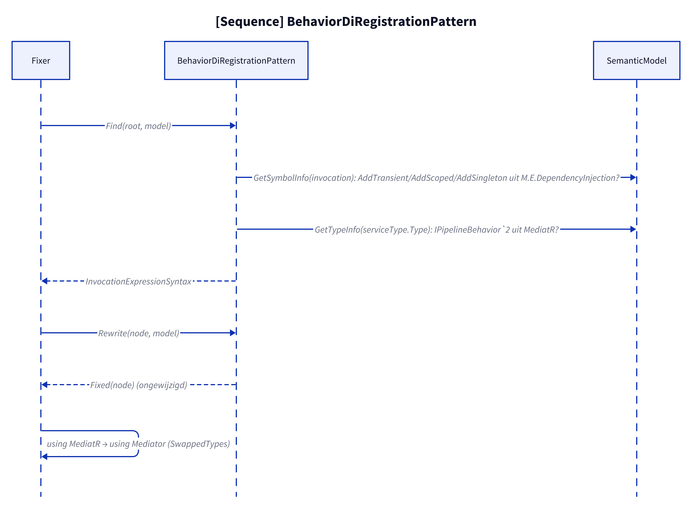
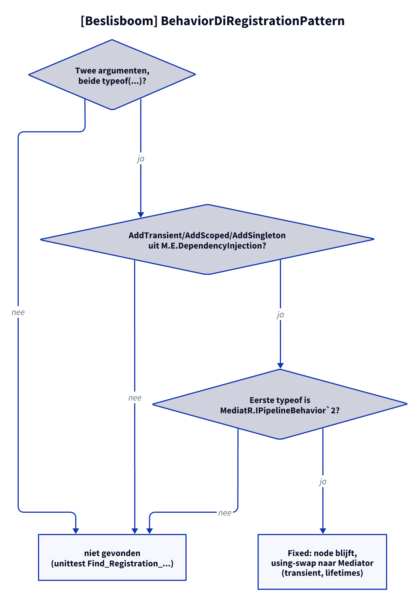

# Modellen: mediatr.behavior-di-registration

Feiten uit `src/Unshackle.Core/Fixes/MediatR/Patterns/BehaviorDiRegistrationPattern.cs`.

## Figuur 1: klassen

**Figure 1.** `BehaviorDiRegistrationPattern` en de typen die hij herkent.

<!-- kingmadoc:diagram img/mediatr-behavior-di-registration-modellen-1.d2 -->

| Element                              | Rol                                                                                  |
| ------------------------------------ | ------------------------------------------------------------------------------------ |
| `BehaviorDiRegistrationPattern`      | Vindt de DI-registratie, geeft de node ongewijzigd `Fixed` terug                     |
| `IPattern`                           | `Find` + `Rewrite`                                                                   |
| `FixedResult`                        | `NewNodes` = de originele aanroep, geen `Warning`                                    |
| `ServiceCollectionServiceExtensions` | `AddTransient`/`AddScoped`/`AddSingleton(Type, Type)`                                |
| `MediatR.IPipelineBehavior<,>`       | Herkend type; `MediatRFix.SwappedTypes` maakt er `Mediator.IPipelineBehavior<,>` van |

## Figuur 2: sequence

**Figure 2.** Van `Fixer` via `Find` en `Rewrite` naar `Fixed`.

<!-- kingmadoc:diagram img/mediatr-behavior-di-registration-modellen-2.d2 -->

| Stap      | Methode in de code              | Wat gebeurt er                                        |
| --------- | ------------------------------- | ----------------------------------------------------- |
| Vinden    | `Find`, `GetSymbolInfo`         | `Add*` uit `Microsoft.Extensions.DependencyInjection` |
| Type      | `GetTypeInfo(serviceType.Type)` | eerste `typeof` is `IPipelineBehavior\`2`uit`MediatR` |
| Schrijven | `PatternResult.Fixed(node)`     | node blijft; de Fixer swapt daarna de using           |

## Figuur 3: beslisboom

**Figure 3.** Vragen van `Find`/`Rewrite`.

<!-- kingmadoc:diagram img/mediatr-behavior-di-registration-modellen-3.d2 -->

| Blad          | Voorwaarde                                                                      | Bewijs                         |
| ------------- | ------------------------------------------------------------------------------- | ------------------------------ |
| niet gevonden | geen twee `typeof`-argumenten, ander `Add*` of ander type                       | unittest `Find_Registration_…` |
| blijft staan  | `AddTransient/AddScoped/AddSingleton(typeof(IPipelineBehavior<..>), typeof(X))` | `transient`, `lifetimes`       |

## Zie ook

- [mediatr-behavior-di-registration-plan.md](mediatr-behavior-di-registration-plan.md)
- [mediatr-behavior-di-registration-verify.md](mediatr-behavior-di-registration-verify.md)
- `src/Unshackle.Core/Fixes/MediatR/Patterns/BehaviorDiRegistrationPattern.cs`
- `src/Unshackle.Tests/Proofs/MediatR/BehaviorDiRegistration/`
