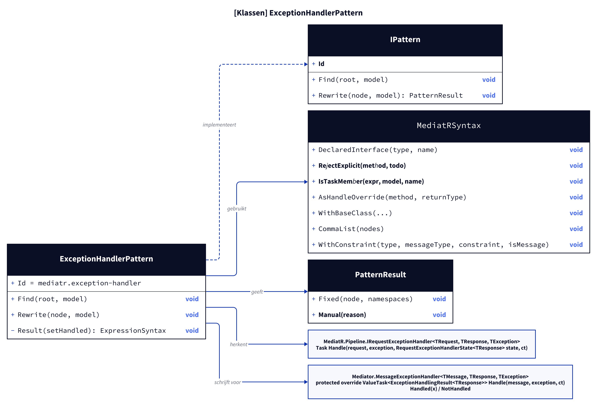
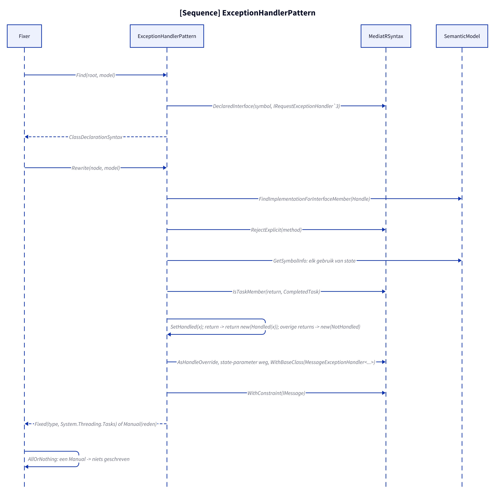
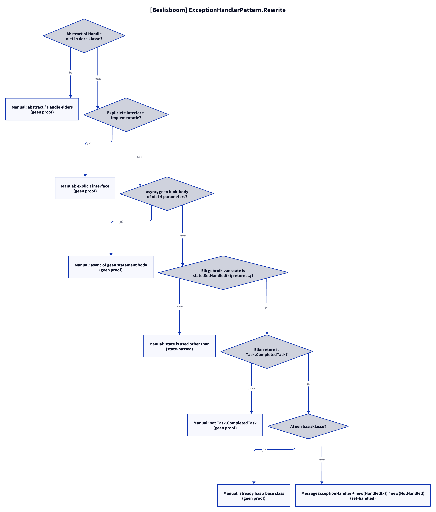

# Models: mediatr.exception-handler

Facts from `src/Unshackle.Core/Fixes/MediatR/Patterns/ExceptionHandlerPattern.cs` and `MediatRSyntax.cs`.

## Figure 1: classes

**Figure 1.** `ExceptionHandlerPattern`, its helper and the MediatR and Mediator types.

<!-- kingmadoc:diagram img/mediatr-exception-handler-modellen-1.d2 -->

| Element | Role |
| ------- | ---- |
| `ExceptionHandlerPattern` | Finds classes that declare `MediatR.Pipeline.IRequestExceptionHandler<,,>` themselves and rewrites them |
| `MediatRSyntax` | `DeclaredInterface`, `RejectExplicit`, `IsTaskMember`, `AsHandleOverride`, `WithBaseClass`, `CommaList`, `WithConstraint` |
| `MessageExceptionHandler<,,>` | Mediator base class with `Handled(x)` and `NotHandled` |

## Figure 2: sequence

**Figure 2.** From `Fixer` via `Find` and `Rewrite` to `Fixed` or `Manual`.

<!-- kingmadoc:diagram img/mediatr-exception-handler-modellen-2.d2 -->

| Step | Method in the code | What happens |
| ---- | ------------------ | ------------ |
| Find | `MediatRSyntax.DeclaredInterface` (`IRequestExceptionHandler\`3`) | Only classes that declare the interface themselves |
| `state` | `GetSymbolInfo` per identifier | Every use must be `state.SetHandled(x);` directly followed by a `return` |
| Rewrite | `ReplaceNodes`, `Result`, `AsHandleOverride` | `return new(Handled(x))` / `new(NotHandled)`, `state` parameter removed, `protected override ValueTask<ExceptionHandlingResult<TRes>>` |
| Base class | `WithBaseClass`, `WithConstraint` | `MessageExceptionHandler<TReq, TRes, TEx>`, `IMessage` on a type-parameter request |
| Fix | `IFix.AllOrNothing` | One Manual in the solution: nothing written |

## Figure 3: decision tree

**Figure 3.** Questions of `Rewrite`.

<!-- kingmadoc:diagram img/mediatr-exception-handler-modellen-3.d2 -->

| Leaf | Condition | Evidence |
| ---- | --------- | -------- |
| Manual "Abstract exception handler or Handle not declared" | abstract or `Handle` in a base class | no proof |
| Manual "explicit interface" | `Handle` implemented explicitly | no proof |
| Manual "async or has no statement body" | `async`, an expression body or not 4 parameters | no proof |
| Manual "state is used other than" | `state` passed on or stored | `ExceptionHandler/state-passed` |
| Manual "not Task.CompletedTask" | another return | no proof |
| Manual "already has a base class" | an own base class | no proof |
| Fixed | otherwise | `ExceptionHandler/set-handled` |

## See also

- [mediatr-exception-handler-plan.md](mediatr-exception-handler-plan.md)
- [mediatr-exception-handler-verify.md](mediatr-exception-handler-verify.md)
- `src/Unshackle.Core/Fixes/MediatR/Patterns/ExceptionHandlerPattern.cs`
- `src/Unshackle.Tests/Proofs/MediatR/ExceptionHandler/`
