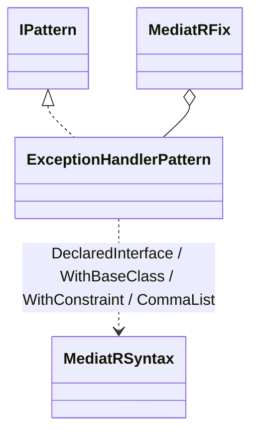
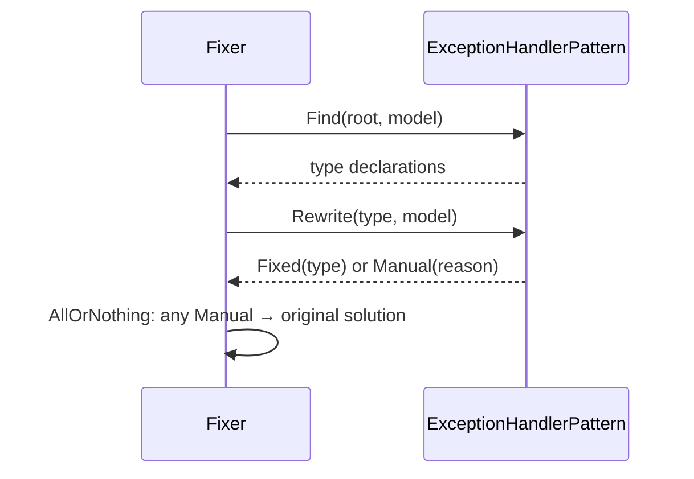

# Modellen: mediatr.exception-handler

Feiten uit `src/Unshackle.Core/Fixes/MediatR/Patterns/ExceptionHandlerPattern.cs` en `MediatRSyntax.cs`.

## Figuur 1: klassen



## Figuur 2: sequence



## Figuur 3: beslisboom

```text
abstract or Handle elsewhere? -> Manual
async / no block body? -> Manual
state only as SetHandled + return? -> no: Manual
all returns Task.CompletedTask? -> no: Manual
already a base class? -> Manual
else: Fixed
```
