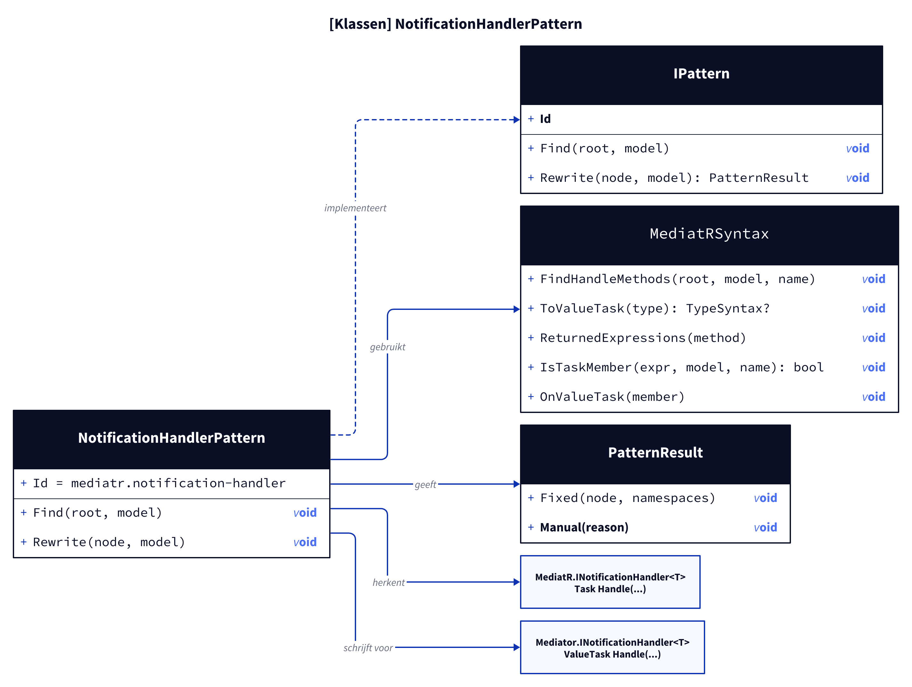
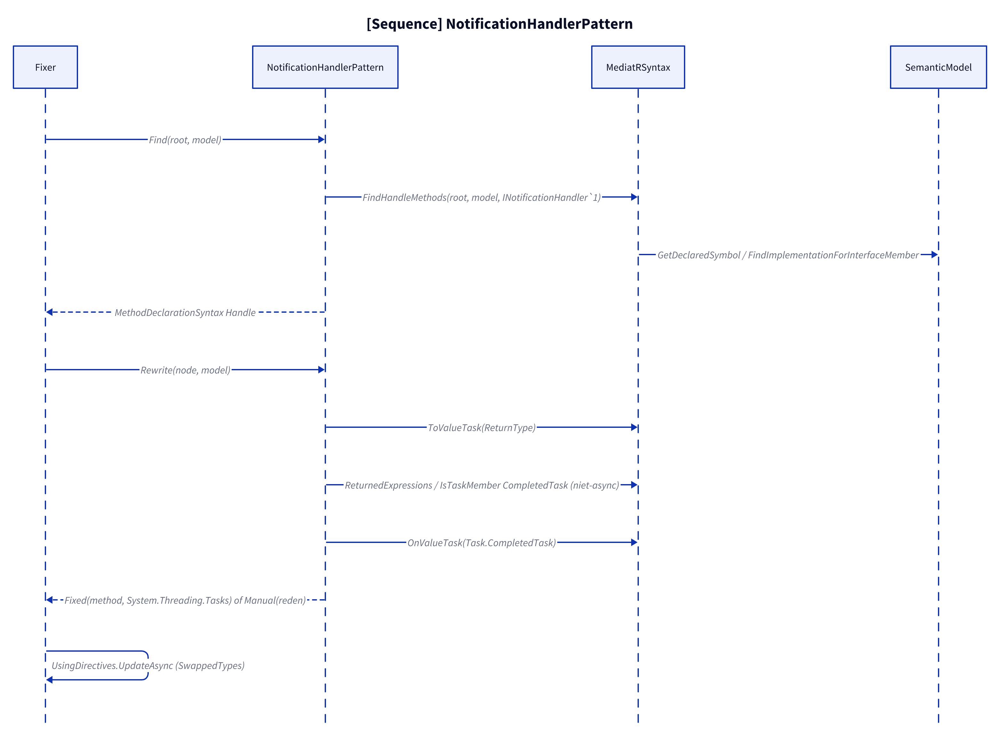
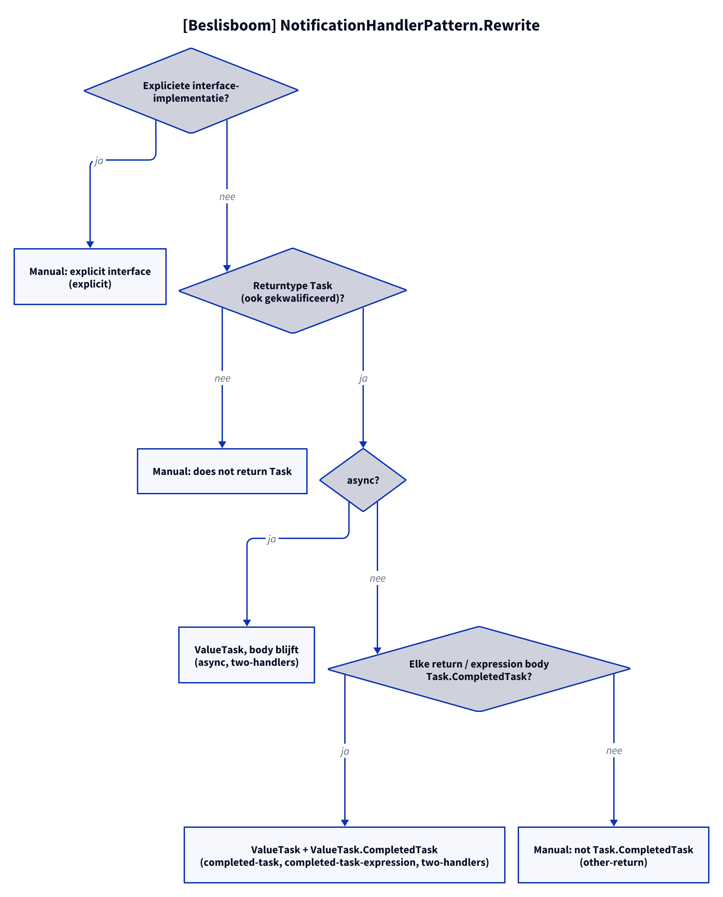

# Models: mediatr.notification-handler

Facts from `src/Unshackle.Core/Fixes/MediatR/Patterns/NotificationHandlerPattern.cs` and `MediatRSyntax.cs`.

## Figure 1: classes

**Figure 1.** `NotificationHandlerPattern`, its helper and the MediatR and Mediator types.

<!-- kingmadoc:diagram img/mediatr-notification-handler-modellen-1.d2 -->

| Element                      | Role                                                                                     |
| ---------------------------- | ---------------------------------------------------------------------------------------- |
| `NotificationHandlerPattern` | Finds `Handle` of `MediatR.INotificationHandler<T>` and turns it into `ValueTask Handle`  |
| `MediatRSyntax`              | Shared helper: finding, `Task`→`ValueTask`, returns, `Task.X` → `ValueTask.X`             |
| `Mediator.INotificationHandler<T>` | Same name (in `SwappedTypes`), `Handle` returns `ValueTask`                         |

## Figure 2: sequence

**Figure 2.** From `Fixer` via `Find` and `Rewrite` to `Fixed` or `Manual`.

<!-- kingmadoc:diagram img/mediatr-notification-handler-modellen-2.d2 -->

| Step        | Method in the code                                         | What happens                                               |
| ----------- | ---------------------------------------------------------- | ---------------------------------------------------------- |
| Find        | `MediatRSyntax.FindHandleMethods` (`INotificationHandler<>`) | Semantically the `Handle` that implements the interface member |
| Return type | `MediatRSyntax.ToValueTask`                                | `Task` → `ValueTask`                                       |
| non-async   | `ReturnedExpressions`, `IsTaskMember`, `OnValueTask`       | `Task.CompletedTask` → `ValueTask.CompletedTask`           |

## Figure 3: decision tree

**Figure 3.** Questions of `Rewrite`.

<!-- kingmadoc:diagram img/mediatr-notification-handler-modellen-3.d2 -->

| Leaf                                | Condition                                     | Evidence                                                                |
| ----------------------------------- | --------------------------------------------- | ----------------------------------------------------------------------- |
| Manual "explicit interface"         | `Task INotificationHandler<T>.Handle`         | `NotificationHandler/explicit`                                          |
| Manual "does not return Task"       | return type not in the form `Task` (e.g. an alias) | no proof                                                           |
| `ValueTask`, the body stays         | `async`                                       | `NotificationHandler/async`, `two-handlers`                             |
| `ValueTask` + `ValueTask.CompletedTask` | non-async, all returns `Task.CompletedTask` | `NotificationHandler/completed-task`, `completed-task-expression`, `two-handlers` |
| Manual "not Task.CompletedTask"     | another return, e.g. `Task.Delay`             | `NotificationHandler/other-return`                                      |

## See also

- [mediatr-notification-handler-plan.md](mediatr-notification-handler-plan.md)
- [mediatr-notification-handler-verify.md](mediatr-notification-handler-verify.md)
- `src/Unshackle.Core/Fixes/MediatR/Patterns/NotificationHandlerPattern.cs`
- `src/Unshackle.Tests/Proofs/MediatR/NotificationHandler/`
