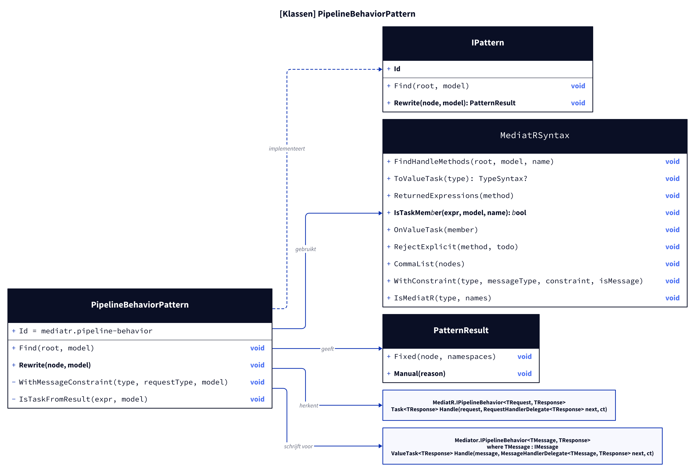
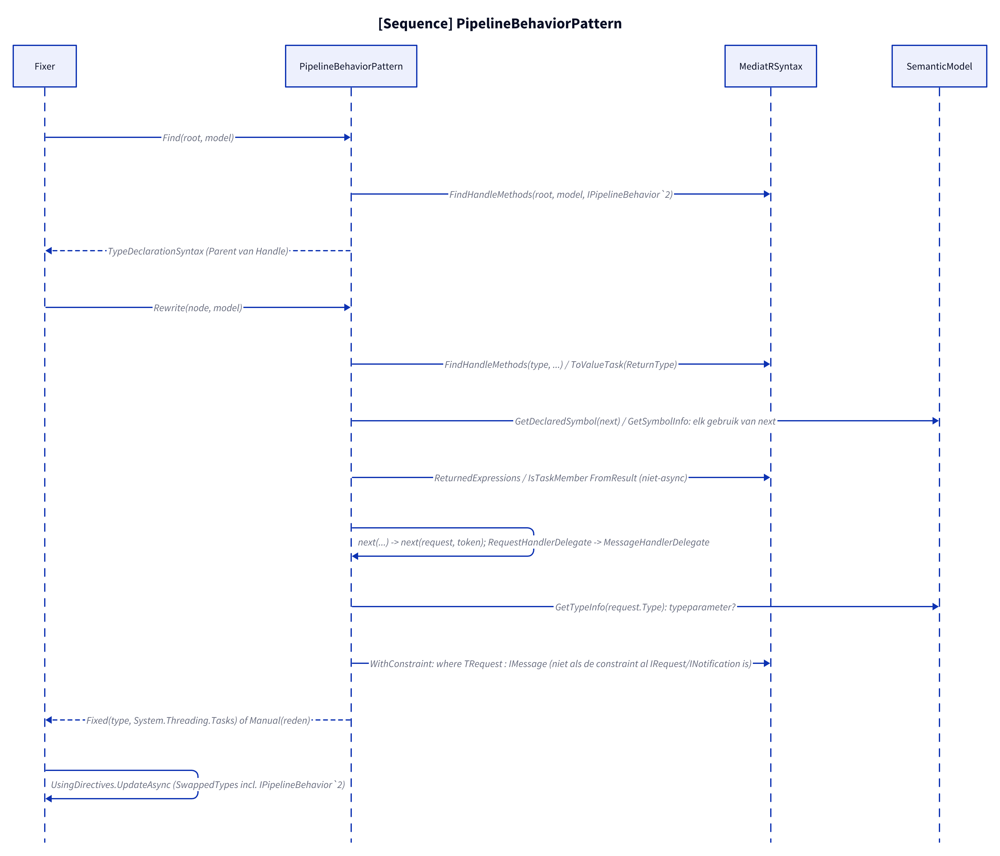
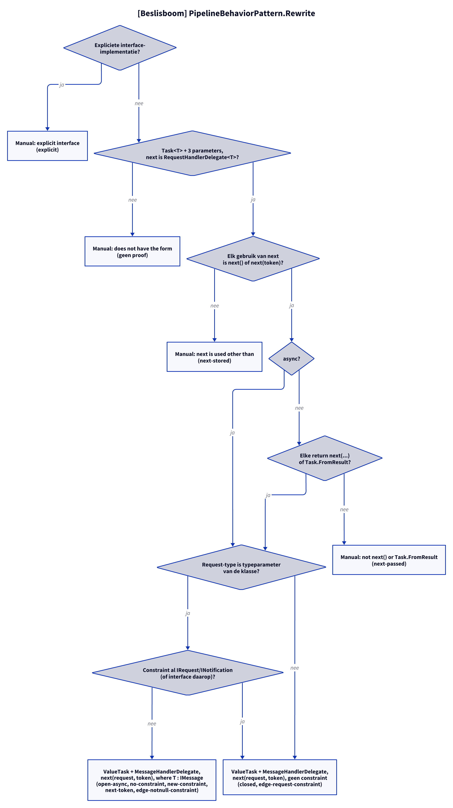

# Modellen: mediatr.pipeline-behavior

Feiten uit `src/Unshackle.Core/Fixes/MediatR/Patterns/PipelineBehaviorPattern.cs` en `MediatRSyntax.cs`.

## Figuur 1: klassen

**Figure 1.** `PipelineBehaviorPattern`, zijn helper en de MediatR- en Mediator-typen.

<!-- kingmadoc:diagram img/mediatr-pipeline-behavior-modellen-1.d2 -->

| Element                         | Rol                                                                                             |
| ------------------------------- | ----------------------------------------------------------------------------------------------- |
| `PipelineBehaviorPattern`       | Vindt het type met `Handle` van `MediatR.IPipelineBehavior<,>` en herschrijft het type          |
| `MediatRSyntax`                 | Vinden (nu ook met het type zelf als root), `Task`→`ValueTask`, returns, `Task.X`→`ValueTask.X`, `RejectExplicit`, `CommaList`, `WithConstraint` |
| `Mediator.IPipelineBehavior<,>` | Zelfde naam (nu in `SwappedTypes`), andere `Handle` en `IMessage`-constraint                    |

## Figuur 2: sequence

**Figure 2.** Van `Fixer` via `Find` en `Rewrite` naar `Fixed` of `Manual`.

<!-- kingmadoc:diagram img/mediatr-pipeline-behavior-modellen-2.d2 -->

| Stap         | Methode in de code                                         | Wat gebeurt er                                                                       |
| ------------ | ---------------------------------------------------------- | ------------------------------------------------------------------------------------ |
| Vinden       | `MediatRSyntax.FindHandleMethods` (`IPipelineBehavior\`2`) | Het type (Parent van `Handle`), want de constraint staat op het type                 |
| `next`       | `GetDeclaredSymbol` / `GetSymbolInfo`                      | Elk gebruik van de parameter moet een aanroep zijn                                   |
| Herschrijven | `ReplaceNodes`, `CommaList`, `OnValueTask`                 | `next(request, token)`, `MessageHandlerDelegate<TReq, TRes>`, `ValueTask.FromResult` |
| Constraint   | `WithMessageConstraint` → `MediatRSyntax.WithConstraint`   | `IMessage` op een typeparameter-request, tenzij de constraint al een MediatR-bericht is (TAAK-081) |

## Figuur 3: beslisboom

**Figure 3.** Vragen van `Rewrite`.

<!-- kingmadoc:diagram img/mediatr-pipeline-behavior-modellen-3.d2 -->

| Blad                                   | Voorwaarde                              | Bewijs                                                        |
| -------------------------------------- | --------------------------------------- | ------------------------------------------------------------- |
| Manual "explicit interface"            | `IPipelineBehavior<,>.Handle` expliciet | `PipelineBehavior/explicit`                                   |
| Manual "does not have the form"        | geen `Task<T>`, andere parameters       | geen proof                                                    |
| Manual "next is used other than"       | `next` opgeslagen of doorgegeven        | `PipelineBehavior/next-stored`                                |
| Manual "not next() or Task.FromResult" | niet-async, andere return               | `PipelineBehavior/next-passed`                                |
| Fixed + `where T : IMessage`           | request is typeparameter                | `open-async`, `no-constraint`, `new-constraint`, `next-token`, `edge-notnull-constraint` |
| Fixed zonder extra constraint          | constraint al `IRequest<T>`/`INotification` (of eigen interface daarop) | `PipelineBehavior/edge-request-constraint` |
| Fixed zonder constraint                | gesloten request-type                   | `PipelineBehavior/closed`                                     |

## Zie ook

- [mediatr-pipeline-behavior-plan.md](mediatr-pipeline-behavior-plan.md)
- [mediatr-pipeline-behavior-verify.md](mediatr-pipeline-behavior-verify.md)
- `src/Unshackle.Core/Fixes/MediatR/Patterns/PipelineBehaviorPattern.cs`
- `src/Unshackle.Tests/Proofs/MediatR/PipelineBehavior/`
