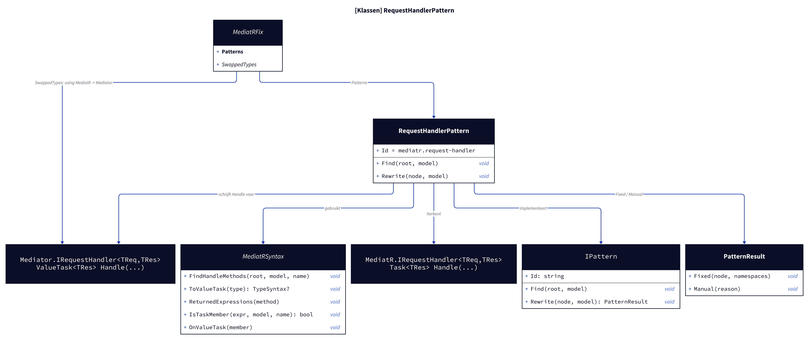
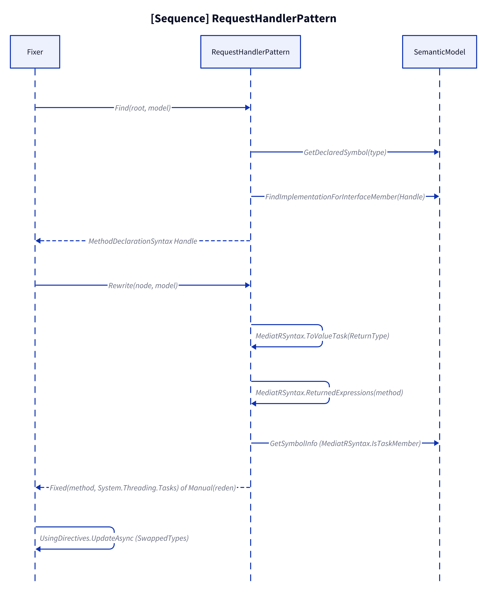
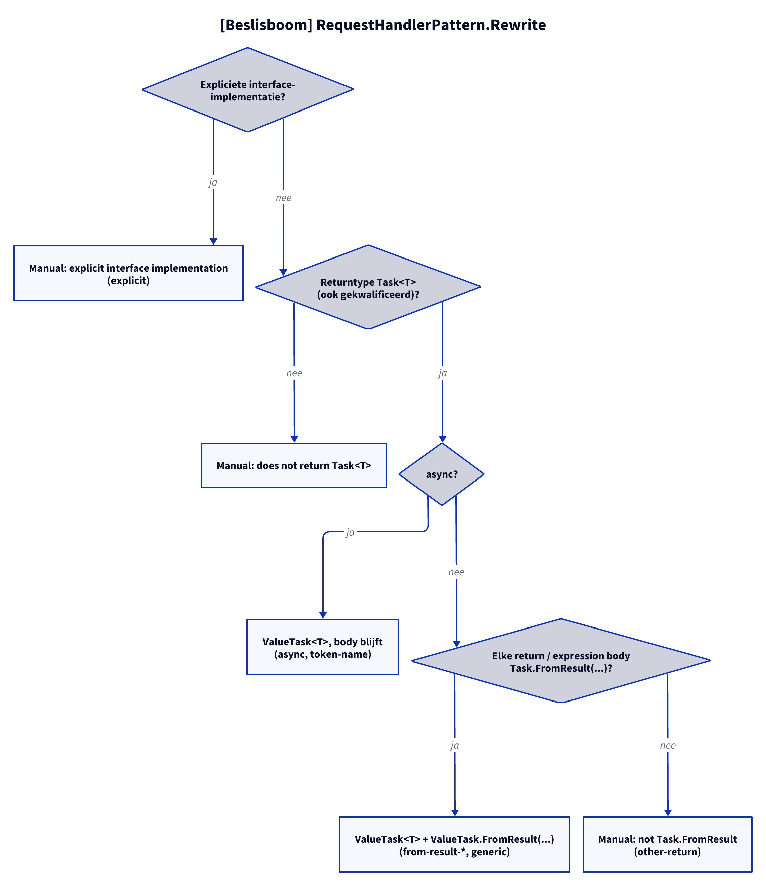

# Modellen: mediatr.request-handler

Feiten uit `src/Unshackle.Core/Fixes/MediatR/Patterns/RequestHandlerPattern.cs` en `MediatRFix.SwappedTypes`.

## Figuur 1: klassen

**Figure 1.** `RequestHandlerPattern`, zijn contract en de MediatR- en Mediator-typen.

<!-- kingmadoc:diagram img/mediatr-request-handler-modellen-1.d2 -->

| Element                 | Rol                                                                                                                                |
| ----------------------- | ---------------------------------------------------------------------------------------------------------------------------------- |
| `RequestHandlerPattern` | Vindt `Handle` van elke klasse die `MediatR.IRequestHandler<,>` implementeert en herschrijft returntype en returns                 |
| `MediatRFix`            | Registreert het pattern; `SwappedTypes` laat `using MediatR` → `using Mediator` wisselen terwijl `IRequestHandler<,>` blijft staan |
| `PatternResult`         | `Fixed(method, "System.Threading.Tasks")` of `Manual(reden)`                                                                       |
| MediatR 12.5.0          | `Task<TRes> Handle(TReq, CancellationToken)`                                                                                       |
| Mediator 3.0.2          | `ValueTask<TRes> Handle(TReq, CancellationToken)`                                                                                  |

## Figuur 2: sequence

**Figure 2.** Van `Find` tot de using-swap door de `Fixer`.

<!-- kingmadoc:diagram img/mediatr-request-handler-modellen-2.d2 -->

| Stap       | Methode in de code                                                                       | Wat gebeurt er                                                                                  |
| ---------- | ---------------------------------------------------------------------------------------- | ----------------------------------------------------------------------------------------------- |
| Vinden     | `MediatRSyntax.FindHandleMethods` (`IRequestHandler<,>`) | Semantisch: de `Handle`-methode die het interface-lid implementeert, in dezelfde klasse         |
| Returntype | `MediatRSyntax.ToValueTask`                                                                          | `Task<T>` of `System.Threading.Tasks.Task<T>` → `ValueTask<T>`                                  |
| Returns    | `MediatRSyntax.ReturnedExpressions`, `IsTaskMember(..., "FromResult")`                                                | Expression body of elke `return` (niet in lambda's/lokale functies) moet `Task.FromResult` zijn |
| Usings     | `UsingDirectives.UpdateAsync` in `Fixer`                                                 | `using MediatR` → `using Mediator` dankzij `SwappedTypes`                                       |

## Figuur 3: beslisboom

**Figure 3.** Vragen van `Rewrite`.

<!-- kingmadoc:diagram img/mediatr-request-handler-modellen-3.d2 -->

| Blad                                       | Voorwaarde                                       | Bewijs                                                                  |
| ------------------------------------------ | ------------------------------------------------ | ----------------------------------------------------------------------- |
| Manual "explicit interface implementation" | `Task<T> IRequestHandler<A,B>.Handle`            | `RequestHandler/explicit`                                               |
| Manual "does not return Task<T>"           | returntype niet in de vorm `Task<T>` (bv. alias) | geen proof (kan niet compileren met MediatR zonder alias)               |
| `ValueTask<T>`, body ongewijzigd           | `async`                                          | `RequestHandler/async`, `RequestHandler/token-name`                     |
| `ValueTask<T>` + `ValueTask.FromResult`    | niet-async, alle returns `Task.FromResult`       | `RequestHandler/from-result-expression`, `from-result-block`, `generic` |
| Manual "not Task.FromResult"               | andere return, bv. `Task.Run`                    | `RequestHandler/other-return`                                           |

## Zie ook

- [mediatr-request-handler-plan.md](mediatr-request-handler-plan.md)
- [mediatr-request-handler-verify.md](mediatr-request-handler-verify.md)
- `src/Unshackle.Core/Fixes/MediatR/Patterns/RequestHandlerPattern.cs`
- `src/Unshackle.Tests/Proofs/MediatR/RequestHandler/`
