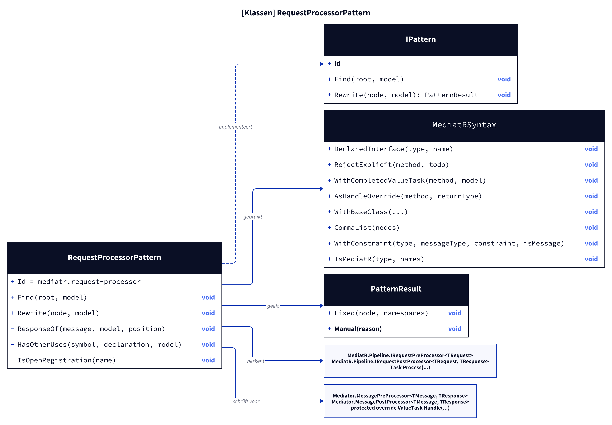
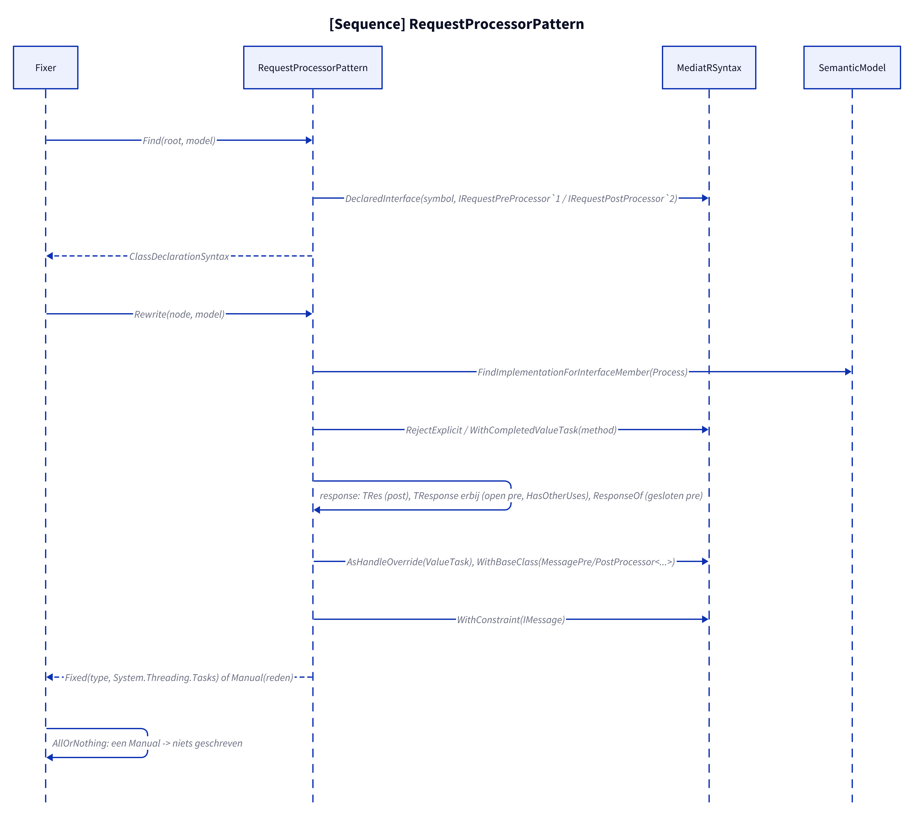
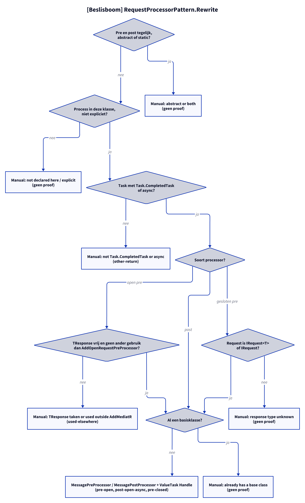

# Models: mediatr.request-processor

Facts from `src/Unshackle.Core/Fixes/MediatR/Patterns/RequestProcessorPattern.cs` and `MediatRSyntax.cs`.

## Figure 1: classes

**Figure 1.** `RequestProcessorPattern`, its helper and the MediatR and Mediator types.

<!-- kingmadoc:diagram img/mediatr-request-processor-modellen-1.d2 -->

| Element | Role |
| ------- | ---- |
| `RequestProcessorPattern` | Finds classes that declare `IRequestPreProcessor<>` or `IRequestPostProcessor<,>` themselves and rewrites them |
| `MediatRSyntax` | `DeclaredInterface`, `RejectExplicit`, `WithCompletedValueTask`, `AsHandleOverride`, `WithBaseClass`, `CommaList`, `WithConstraint` |
| `MessagePreProcessor<,>` / `MessagePostProcessor<,>` | Mediator base classes with `protected override ValueTask Handle(...)` |

## Figure 2: sequence

**Figure 2.** From `Fixer` via `Find` and `Rewrite` to `Fixed` or `Manual`.

<!-- kingmadoc:diagram img/mediatr-request-processor-modellen-2.d2 -->

| Step | Method in the code | What happens |
| ---- | ------------------ | ------------ |
| Find | `MediatRSyntax.DeclaredInterface` (`IRequestPreProcessor\`1`, `IRequestPostProcessor\`2`) | Only classes that declare the interface themselves |
| Body | `RejectExplicit`, `WithCompletedValueTask` | `Task.CompletedTask` → `ValueTask.CompletedTask`, other `Task` → `new ValueTask(expr)`, or async |
| Response | `MediatRSyntax.ResponseOf` | post: `TRes`; open pre: new type parameter `TResponse`; closed pre: `T` of `IRequest<T>` or `Unit` |
| Base class | `AsHandleOverride`, `WithBaseClass`, `WithConstraint` | `MessagePre/PostProcessor<TReq, TRes>`, `IMessage` on a type-parameter request |
| Fix | `IFix.AllOrNothing` | One Manual in the solution: nothing written |

## Figure 3: decision tree

**Figure 3.** Questions asked by `Rewrite`.

<!-- kingmadoc:diagram img/mediatr-request-processor-modellen-3.d2 -->

| Leaf | Condition | Proof |
| ---- | --------- | ----- |
| Manual "Abstract or both" | pre and post at once, abstract or static | no proof |
| Manual "not declared in this class" / explicit | `Process` in a base class or explicit | no proof |
| Fixed `new ValueTask(expr)` | other `Task` (`Task.Delay`, `Task.Run`) without async | `RequestProcessor/other-return`, `RequestProcessor/task-run` |
| Manual "TResponse ... that name is taken" | open pre-processor with `TResponse` already taken | - (callers: see [mediatr-request-processor-caller-plan.md](mediatr-request-processor-caller-plan.md)) |
| Manual "response type ... unknown" | closed pre-processor without `IRequest`/`IRequest<T>` | no proof |
| Manual "already has a base class" | own base class | no proof |
| Fixed | otherwise | `pre-open`, `post-open-async`, `pre-closed` |

## See also

- [mediatr-request-processor-plan.md](mediatr-request-processor-plan.md)
- [mediatr-request-processor-verify.md](mediatr-request-processor-verify.md)
- `src/Unshackle.Core/Fixes/MediatR/Patterns/RequestProcessorPattern.cs`
- `src/Unshackle.Tests/Proofs/MediatR/RequestProcessor/`
