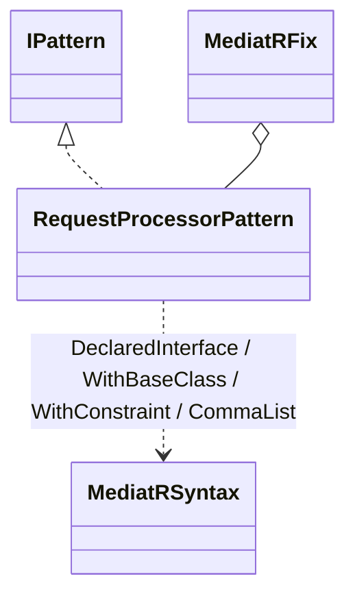
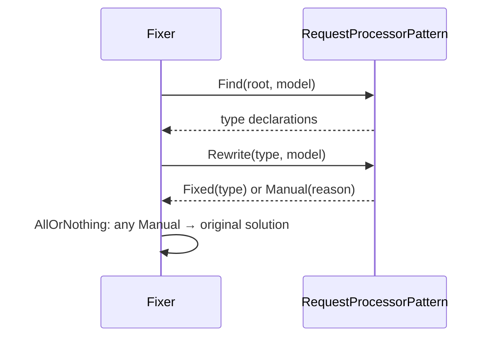

# Modellen: mediatr.request-processor

Feiten uit `src/Unshackle.Core/Fixes/MediatR/Patterns/RequestProcessorPattern.cs` en `MediatRSyntax.cs`.

## Figuur 1: klassen



## Figuur 2: sequence



## Figuur 3: beslisboom

```text
Process declared here, not explicit? -> no: Manual
Task.CompletedTask or async? -> no: Manual
open pre-processor: TResponse free and no other use? -> no: Manual
already a base class? -> yes: Manual
else: Fixed
```
