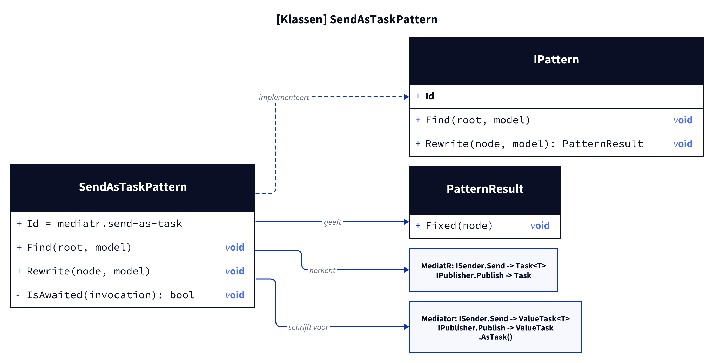
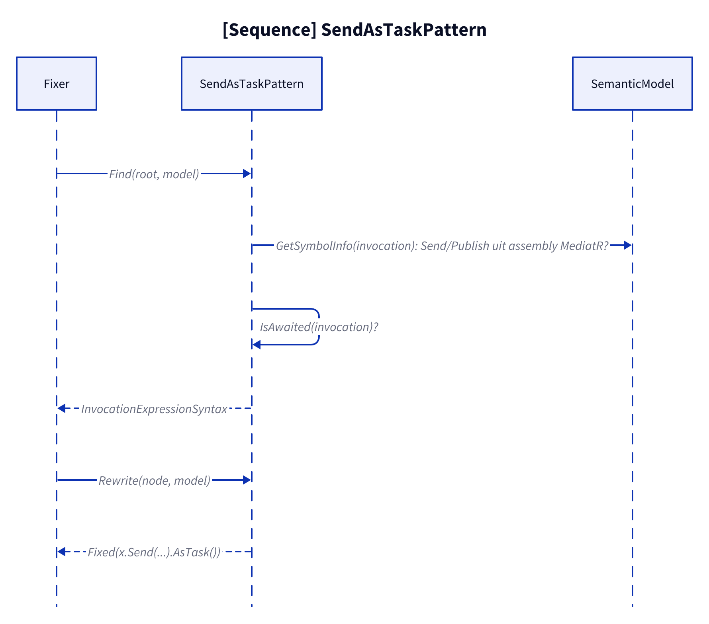
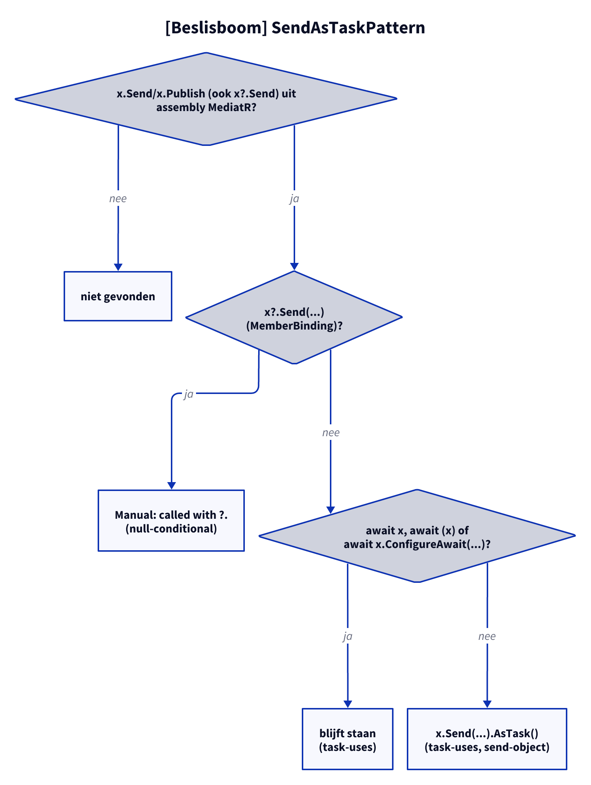

# Modellen: mediatr.send-as-task

Feiten uit `src/Unshackle.Core/Fixes/MediatR/Patterns/SendAsTaskPattern.cs`.

## Figuur 1: klassen

**Figure 1.** `SendAsTaskPattern` en de MediatR- en Mediator-returntypen.

<!-- kingmadoc:diagram img/mediatr-send-as-task-modellen-1.d2 -->

| Element             | Rol                                                               |
| ------------------- | ----------------------------------------------------------------- |
| `SendAsTaskPattern` | Vindt niet-ge-awaite `Send`/`Publish` uit assembly `MediatR`      |
| `IsAwaited`         | `await x`, `await (x)`, `await x.ConfigureAwait(...)` → overslaan |
| MediatR             | `Task<T> Send(...)`, `Task Publish(...)`                          |
| Mediator            | `ValueTask<T> Send(...)`, `ValueTask Publish(...)`, `.AsTask()`   |

## Figuur 2: sequence

**Figure 2.** Van `Fixer` via `Find` en `Rewrite` naar `Fixed`.

<!-- kingmadoc:diagram img/mediatr-send-as-task-modellen-2.d2 -->

| Stap      | Methode in de code                   | Wat gebeurt er                          |
| --------- | ------------------------------------ | --------------------------------------- |
| Vinden    | `Find` met `GetSymbolInfo`           | `Send`/`Publish` uit assembly `MediatR` |
| Filteren  | `IsAwaited`                          | Directe await blijft staan              |
| Schrijven | `SyntaxFactory.InvocationExpression` | `x.Send(...).AsTask()`, trivia behouden |

## Figuur 3: beslisboom

**Figure 3.** Vragen van `Find`/`Rewrite`.

<!-- kingmadoc:diagram img/mediatr-send-as-task-modellen-3.d2 -->

| Blad                   | Voorwaarde                        | Bewijs                     |
| ---------------------- | --------------------------------- | -------------------------- |
| niet gevonden          | geen `Send`/`Publish` van MediatR | n.v.t.                     |
| Manual "called with ?." | `x?.Send(...)` (MemberBinding)  | `null-conditional`         |
| blijft staan           | direct ge-await                   | `task-uses`                |
| `.AsTask()` toegevoegd | elk ander gebruik                 | `task-uses`, `send-object` |

## Zie ook

- [mediatr-send-as-task-plan.md](mediatr-send-as-task-plan.md)
- [mediatr-send-as-task-verify.md](mediatr-send-as-task-verify.md)
- `src/Unshackle.Core/Fixes/MediatR/Patterns/SendAsTaskPattern.cs`
- `src/Unshackle.Tests/Proofs/MediatR/SendAsTask/`
