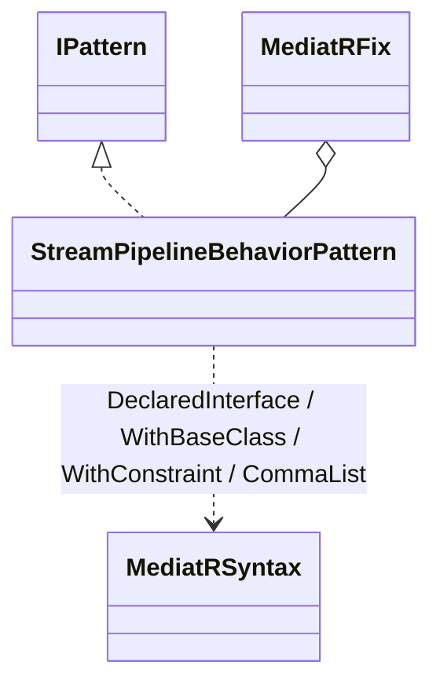
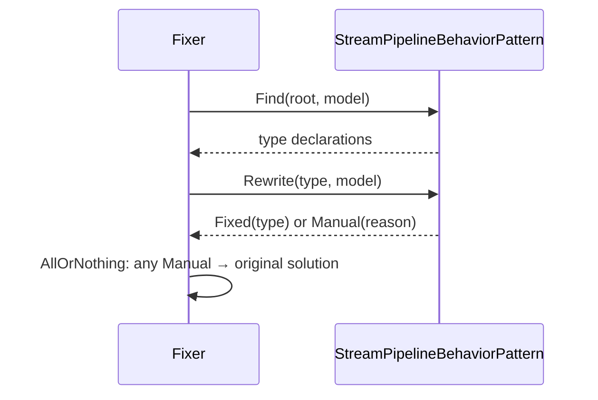

# Modellen: mediatr.stream-pipeline-behavior

Feiten uit `src/Unshackle.Core/Fixes/MediatR/Patterns/StreamPipelineBehaviorPattern.cs` en `MediatRSyntax.cs`.

## Figuur 1: klassen



## Figuur 2: sequence



## Figuur 3: beslisboom

```text
explicit Handle? -> Manual
form Handle(request, StreamHandlerDelegate<T> next, ct)? -> no: Manual
every use of next is next()? -> no: Manual
else: Fixed
```
