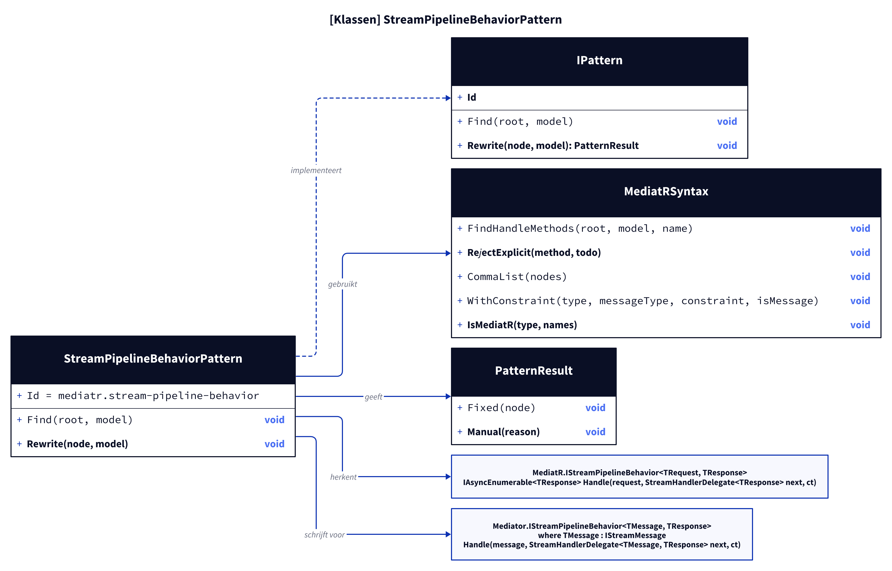
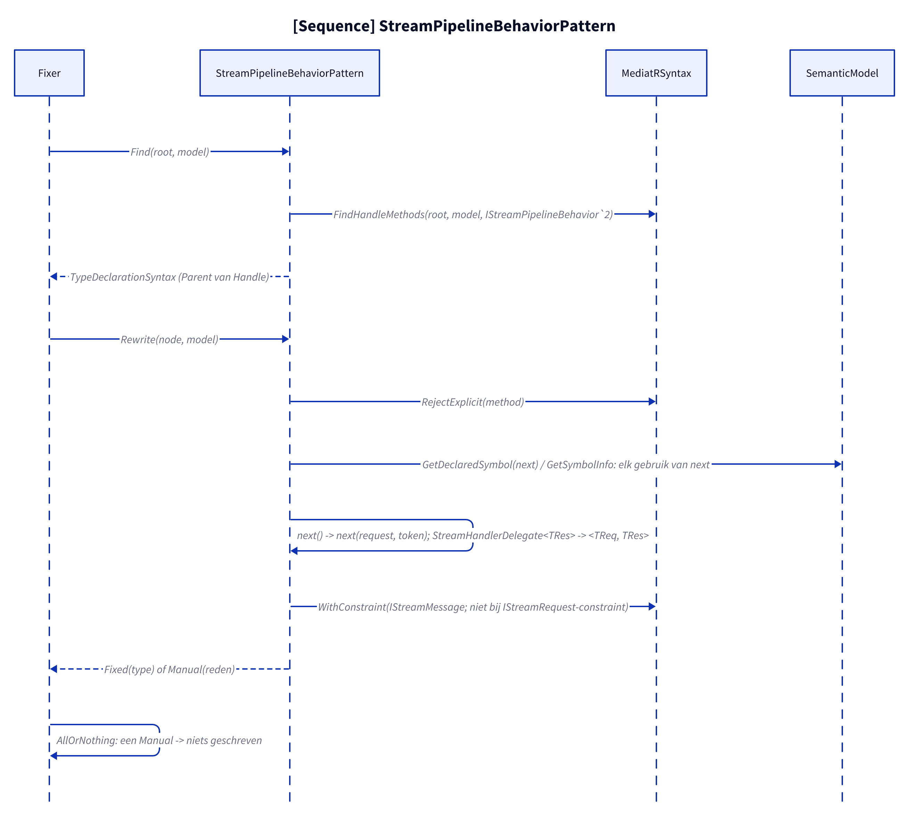
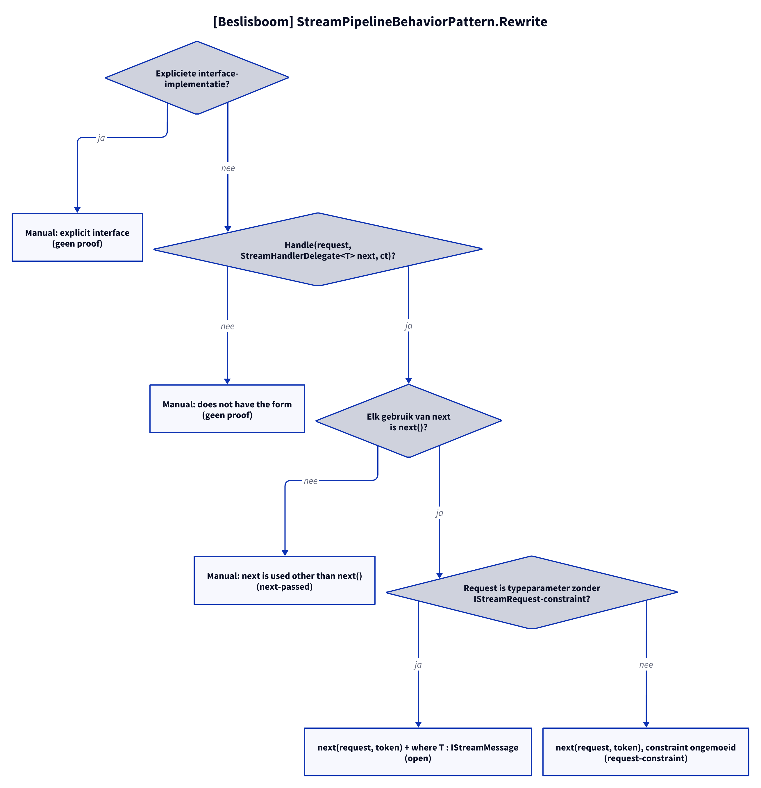

# Modellen: mediatr.stream-pipeline-behavior

Feiten uit `src/Unshackle.Core/Fixes/MediatR/Patterns/StreamPipelineBehaviorPattern.cs` en `MediatRSyntax.cs`.

## Figuur 1: klassen

**Figure 1.** `StreamPipelineBehaviorPattern`, zijn helper en de MediatR- en Mediator-typen.

<!-- kingmadoc:diagram img/mediatr-stream-pipeline-behavior-modellen-1.d2 -->

| Element | Rol |
| ------- | --- |
| `StreamPipelineBehaviorPattern` | Vindt het type met `Handle` van `MediatR.IStreamPipelineBehavior<,>` en herschrijft het type |
| `MediatRSyntax` | `FindHandleMethods`, `RejectExplicit`, `CommaList`, `WithConstraint` |
| `Mediator.IStreamPipelineBehavior<,>` | Zelfde naam, `StreamHandlerDelegate<TMessage, TResponse>` en `IStreamMessage`-constraint |

## Figuur 2: sequence

**Figure 2.** Van `Fixer` via `Find` en `Rewrite` naar `Fixed` of `Manual`.

<!-- kingmadoc:diagram img/mediatr-stream-pipeline-behavior-modellen-2.d2 -->

| Stap | Methode in de code | Wat gebeurt er |
| ---- | ------------------ | -------------- |
| Vinden | `MediatRSyntax.FindHandleMethods` (`IStreamPipelineBehavior\`2`) | Het type (Parent van `Handle`), want de constraint staat op het type |
| `next` | `GetDeclaredSymbol` / `GetSymbolInfo` | Elk gebruik van de parameter moet `next()` zijn |
| Herschrijven | `ReplaceNodes`, `CommaList` | `next(request, token)`, `StreamHandlerDelegate<TReq, TRes>` |
| Constraint | `WithConstraint` | `IStreamMessage` op een typeparameter-request, niet als de constraint al `IStreamRequest<T>` is |
| Fix | `IFix.AllOrNothing` | Eén Manual in de solution: niets geschreven |

## Figuur 3: beslisboom

**Figure 3.** Vragen van `Rewrite`.

<!-- kingmadoc:diagram img/mediatr-stream-pipeline-behavior-modellen-3.d2 -->

| Blad | Voorwaarde | Bewijs |
| ---- | ---------- | ------ |
| Manual "explicit interface" | `Handle` expliciet geïmplementeerd | geen proof |
| Manual "does not have the form" | andere parameters | geen proof |
| Manual "next is used other than as next()" | `next` doorgegeven, opgeslagen of met argumenten | `StreamPipelineBehavior/next-passed` |
| Fixed + `where T : IStreamMessage` | request is typeparameter zonder `IStreamRequest`-constraint | `StreamPipelineBehavior/open` |
| Fixed, constraint ongemoeid | constraint al `IStreamRequest<TResponse>` | `StreamPipelineBehavior/request-constraint` |

## Zie ook

- [mediatr-stream-pipeline-behavior-plan.md](mediatr-stream-pipeline-behavior-plan.md)
- [mediatr-stream-pipeline-behavior-verify.md](mediatr-stream-pipeline-behavior-verify.md)
- `src/Unshackle.Core/Fixes/MediatR/Patterns/StreamPipelineBehaviorPattern.cs`
- `src/Unshackle.Tests/Proofs/MediatR/StreamPipelineBehavior/`
