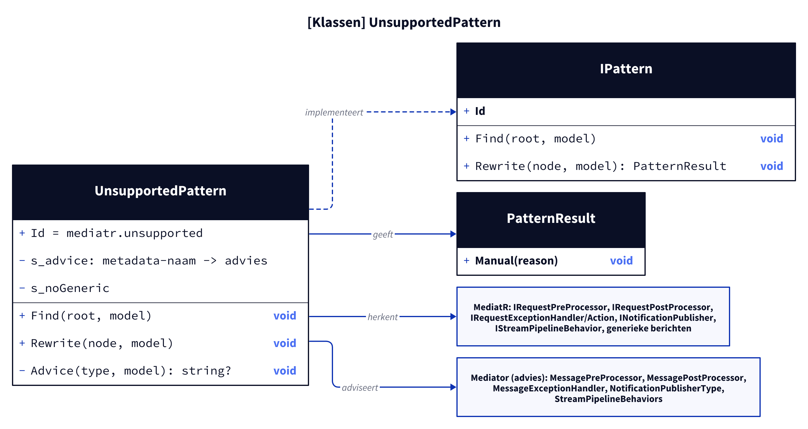
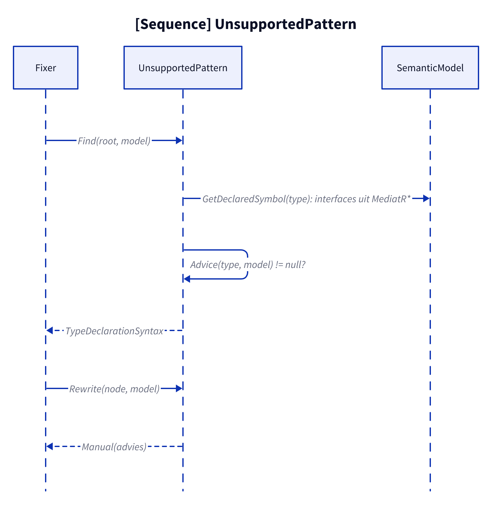
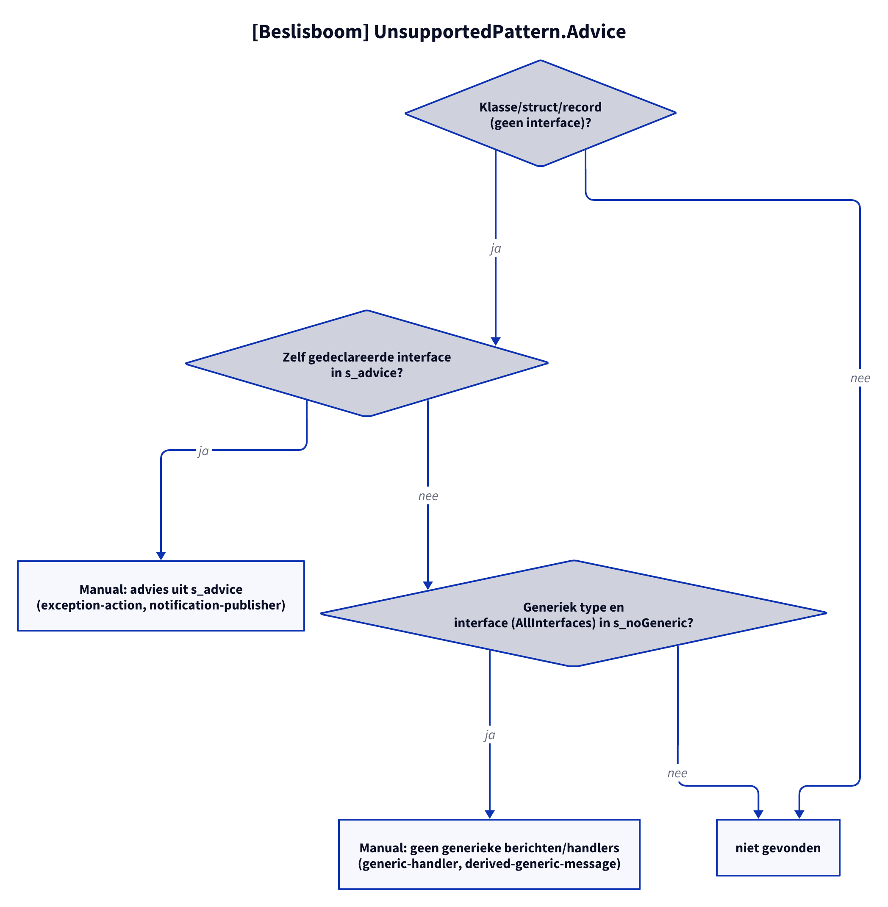

# Models: mediatr.unsupported

Facts from `src/Unshackle.Core/Fixes/MediatR/Patterns/UnsupportedPattern.cs`.

## Figure 1: classes

**Figure 1.** `UnsupportedPattern`, the recognised MediatR interfaces and the Mediator counterparts from the advice.

<!-- kingmadoc:diagram img/mediatr-unsupported-modellen-1.d2 -->

| Element              | Role                                                                 |
| -------------------- | -------------------------------------------------------------------- |
| `UnsupportedPattern` | Finds type declarations with a MediatR interface without a twin      |
| `s_advice`           | Metadata name → advice text (`IRequestExceptionAction`, `INotificationPublisher`) |
| `s_noGeneric`        | Messages and request handlers that must not be generic               |
| `PatternResult`      | Always `Manual(advice)`                                              |

## Figure 2: sequence

**Figure 2.** From `Fixer` via `Find` and `Rewrite` to `Manual`.

<!-- kingmadoc:diagram img/mediatr-unsupported-modellen-2.d2 -->

| Step   | Method in the code                        | What happens                                 |
| ------ | ----------------------------------------- | -------------------------------------------- |
| Find   | `Find` → `Advice` with `GetDeclaredSymbol` | Interface declarations skipped; own `Interfaces` from `MediatR*` for `s_advice`, `AllInterfaces` for generic messages |
| Report | `Rewrite` → `Advice`                      | `Manual` with the advice text                |

## Figure 3: decision tree

**Figure 3.** Questions of `Advice`.

<!-- kingmadoc:diagram img/mediatr-unsupported-modellen-3.d2 -->

| Leaf                               | Condition                                              | Evidence                 |
| ---------------------------------- | ------------------------------------------------------ | ------------------------ |
| Manual `MessageExceptionHandler`   | `IRequestExceptionAction` (declared itself)            | `exception-action`       |
| Manual `NotificationPublisherType` | `INotificationPublisher`                               | `notification-publisher` |
| Manual generic messages            | a generic type + message or request handler (also via a base type) | `generic-handler`, `derived-generic-message` |
| not found                          | an interface declaration or otherwise (pre/post processor, exception handler and stream behavior are patterns of their own) | n/a |

## See also

- [mediatr-unsupported-plan.md](mediatr-unsupported-plan.md)
- [mediatr-unsupported-verify.md](mediatr-unsupported-verify.md)
- `src/Unshackle.Core/Fixes/MediatR/Patterns/UnsupportedPattern.cs`
- `src/Unshackle.Tests/Proofs/MediatR/Unsupported/`
