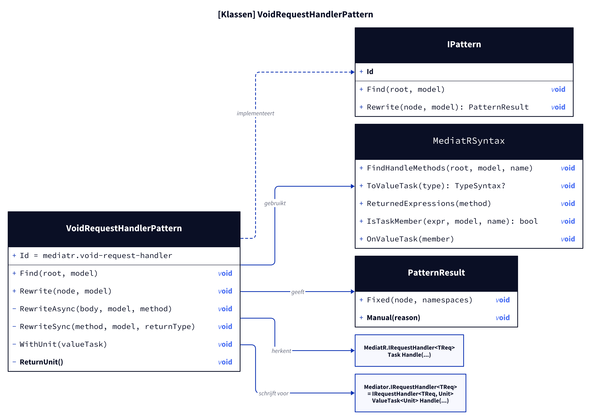
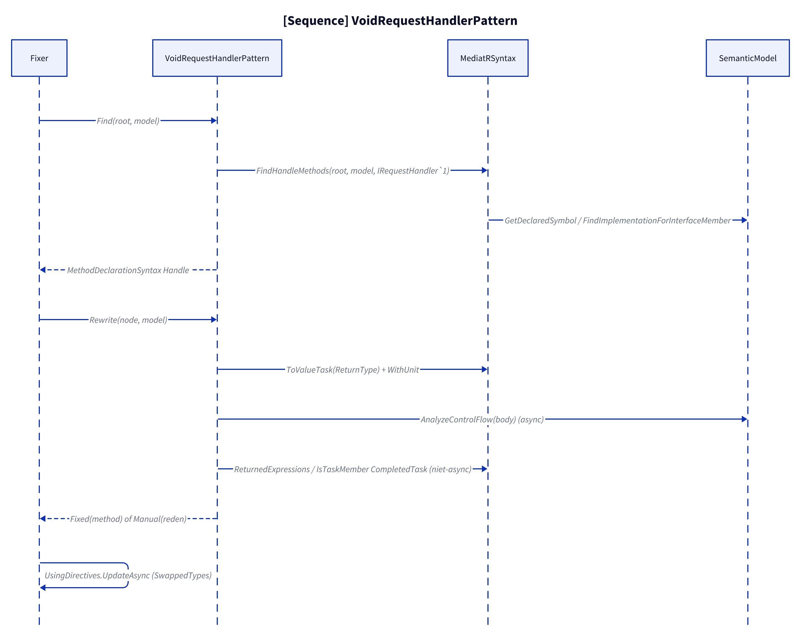
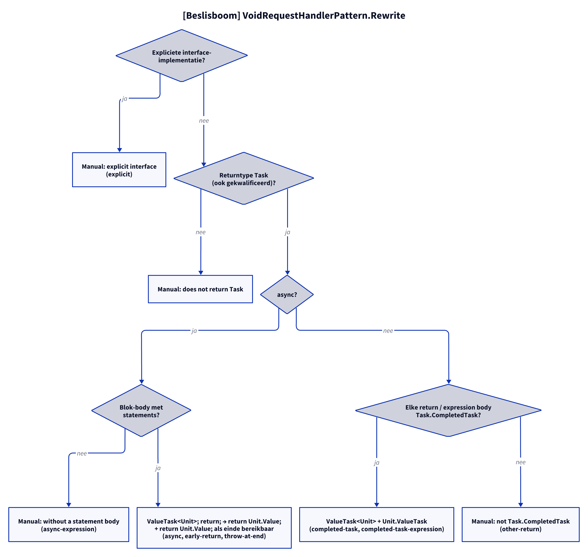

# Modellen: mediatr.void-request-handler

Feiten uit `src/Unshackle.Core/Fixes/MediatR/Patterns/VoidRequestHandlerPattern.cs` en `MediatRSyntax.cs`.

## Figuur 1: klassen

**Figure 1.** `VoidRequestHandlerPattern`, zijn helper en de MediatR- en Mediator-typen.

<!-- kingmadoc:diagram img/mediatr-void-request-handler-modellen-1.d2 -->

| Element                     | Rol                                                                                                   |
| --------------------------- | ----------------------------------------------------------------------------------------------------- |
| `VoidRequestHandlerPattern` | Vindt `Handle` van `MediatR.IRequestHandler<TReq>` en maakt er `ValueTask<Unit> Handle` van            |
| `MediatRSyntax`             | Gedeeld met `RequestHandlerPattern` en `NotificationHandlerPattern`: vinden, `Task`→`ValueTask`, returns |
| `Mediator.IRequestHandler<TReq>` | Is `IRequestHandler<TReq, Unit>`: daarom `ValueTask<Unit>` en `Unit.Value`                       |

## Figuur 2: sequence

**Figure 2.** Van `Fixer` via `Find` en `Rewrite` naar `Fixed` of `Manual`.

<!-- kingmadoc:diagram img/mediatr-void-request-handler-modellen-2.d2 -->

| Stap       | Methode in de code                                           | Wat gebeurt er                                                   |
| ---------- | ------------------------------------------------------------ | ---------------------------------------------------------------- |
| Vinden     | `MediatRSyntax.FindHandleMethods` (`IRequestHandler<>`)      | Semantisch de `Handle` die het interface-lid implementeert       |
| Returntype | `MediatRSyntax.ToValueTask` + `WithUnit`                     | `Task` → `ValueTask<Unit>`                                        |
| async      | `RewriteAsync`, `AnalyzeControlFlow`                         | `return;` → `return Unit.Value;`; bereikbaar einde krijgt er één |
| niet-async | `RewriteSync`, `ReturnedExpressions`, `IsTaskMember`         | `Task.CompletedTask` → `Unit.ValueTask`                          |

## Figuur 3: beslisboom

**Figure 3.** Vragen van `Rewrite`.

<!-- kingmadoc:diagram img/mediatr-void-request-handler-modellen-3.d2 -->

| Blad                                  | Voorwaarde                                    | Bewijs                                                        |
| ------------------------------------- | --------------------------------------------- | ------------------------------------------------------------- |
| Manual "explicit interface"           | `Task IRequestHandler<A>.Handle`              | `VoidRequestHandler/explicit`                                 |
| Manual "does not return Task"         | returntype niet in de vorm `Task` (bv. alias) | geen proof                                                    |
| Manual "without a statement body"     | `async` met expression body                   | `VoidRequestHandler/async-expression`                         |
| `ValueTask<Unit>` + `return Unit.Value` | `async` met blok                             | `VoidRequestHandler/async`, `early-return`, `throw-at-end`    |
| `ValueTask<Unit>` + `Unit.ValueTask`  | niet-async, alle returns `Task.CompletedTask` | `VoidRequestHandler/completed-task`, `completed-task-expression` |
| Manual "not Task.CompletedTask"       | andere return, bv. `Task.Delay`               | `VoidRequestHandler/other-return`                             |

## Zie ook

- [mediatr-void-request-handler-plan.md](mediatr-void-request-handler-plan.md)
- [mediatr-void-request-handler-verify.md](mediatr-void-request-handler-verify.md)
- `src/Unshackle.Core/Fixes/MediatR/Patterns/VoidRequestHandlerPattern.cs`
- `src/Unshackle.Tests/Proofs/MediatR/VoidRequestHandler/`
