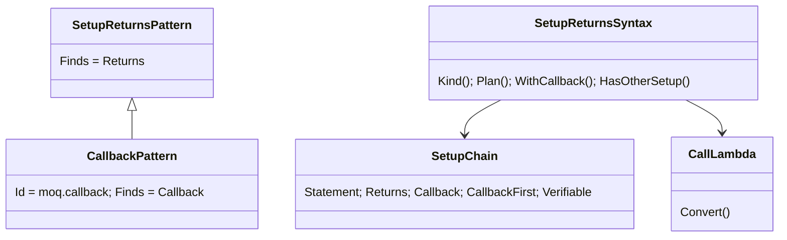
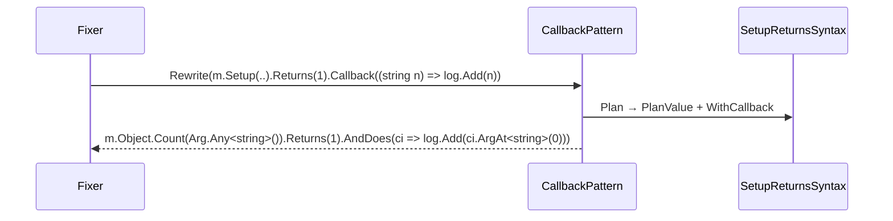

# Models: moq.callback

Facts from `src/Unshackle.Core/Fixes/Moq/Patterns/CallbackPattern.cs` and `SetupReturnsSyntax.WithCallback`.

**Figure 1.** Classes: `CallbackPattern` is `SetupReturnsPattern` for `SetupKind.Callback`; `SetupChain` holds the parsed steps.

**Figure 2.** Order: `moq.verify-all`, `moq.setup-returns`, `moq.returns-lambda`, `moq.throws`, `moq.callback`, `moq.verify`, `moq.create`.

**Figure 3.** Decision tree.

| Question | If no: Manual | Proof |
| --- | --- | --- |
| No Throws, no Returns function in the chain? | `CallbackOrder` | `callback-with-throws`, `callback-before-returns-function`, `returns-function-then-callback` |
| No other setup of the member? | `SetupsOverlap` | `overlapping-setups` |
| A method (not a property) and a plain lambda? | `CallbackShape` | `callback-method-group` |
| A value step? | no: `When(..).Do(..)` | `void-callback` |

## See also

- [moq-callback-plan.md](moq-callback-plan.md)
- [moq-callback-verify.md](moq-callback-verify.md)
