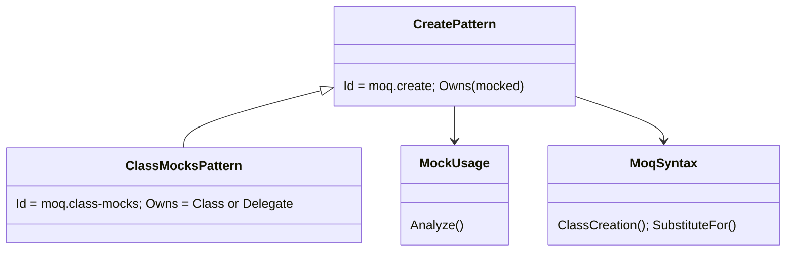
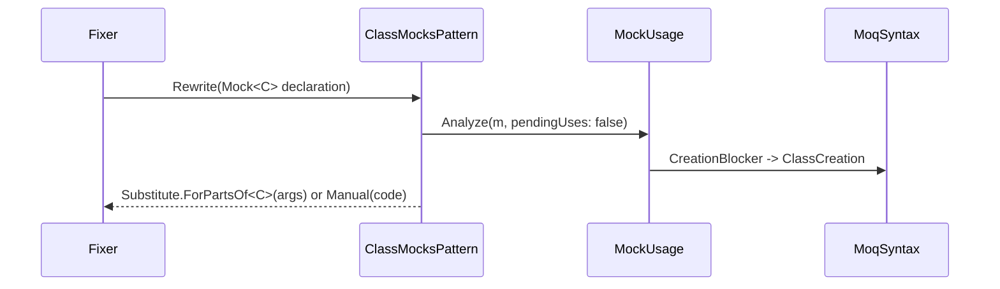

# Models: moq.class-mocks

Facts from `src/Unshackle.Core/Fixes/Moq/Patterns/ClassMocksPattern.cs`, `CreatePattern.cs` and `MoqSyntax.ClassCreation`.

**Figure 1.** Classes: `ClassMocksPattern` is `CreatePattern` that owns class and delegate mocks (`Owns`); `moq.create` owns the rest.

**Figure 2.** Order: ..., `moq.properties`, `moq.class-mocks`, `moq.create`.

**Figure 3.** Decision tree.

| Question                                                  | If no: Manual                              | Proof                                                                                                |
| --------------------------------------------------------- | ------------------------------------------ | ---------------------------------------------------------------------------------------------------- |
| Class (not delegate)?                                     | `ClassMock`                                | `delegate`                                                                                           |
| Not abstract?                                             | `ClassMockAbstract`                        | `abstract`                                                                                           |
| Initializer exactly `CallBase = true`?                    | `ClassMockNoCallBase` / `MockOptions`      | `no-callbase`, `other-options`                                                                       |
| Constructor (params object[]) or (Loose/Default, params)? | `ConstructorArguments` / `StrictBehaviour` | -                                                                                                    |
| Only `.Object` uses?                                      | `ClassMockSetup`                           | `setup`                                                                                              |
| Leaf                                                      | `Substitute.ForPartsOf<C>(args)`           | `callbase`, `callbase-behavior`, `callbase-inline`, `callbase-field`, run-time `class-callbase-pass` |

## See also

- [moq-class-mocks-plan.md](moq-class-mocks-plan.md)
- [moq-class-mocks-verify.md](moq-class-mocks-verify.md)
