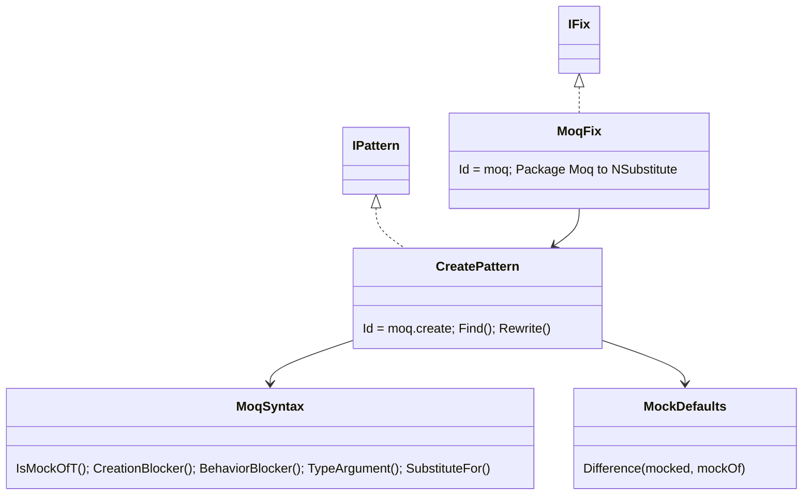
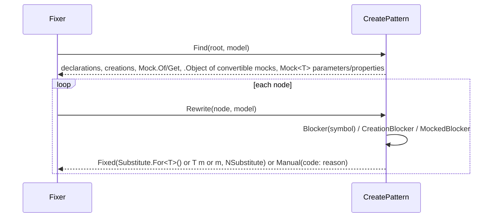

# Models: moq.create

`new Mock<T>()` + `.Object`, `Mock.Of<T>()` → `Substitute.For<T>()`. Facts from `src/Unshackle.Core/Fixes/Moq/Patterns/CreatePattern.cs`.

**Figure 1.** Classes around `CreatePattern`.

| Element | Path | Role |
| --- | --- | --- |
| `MoqFix` | `src/Unshackle.Core/Fixes/Moq/MoqFix.cs` | Strategy for the library: package and using swap, pattern list |
| `CreatePattern` | `src/Unshackle.Core/Fixes/Moq/Patterns/CreatePattern.cs` | This pattern |
| `MoqSyntax` | `src/Unshackle.Core/Fixes/Moq/MoqSyntax.cs` | Recognises `Mock<T>`, `Mock.Of/Get`, `MockBehavior`; builds `Substitute.For<T>()` |
| `MockDefaults` | `src/Unshackle.Core/Fixes/Moq/MockDefaults.cs` | Where unconfigured Moq and NSubstitute answers differ |

**Figure 2.** The Fixer calls `Find` once, then `Rewrite` per node against the original model; the declaration, each assignment
and each `.Object` decide independently with the same `Blocker(symbol)`, so they are rewritten together or not at all.

**Figure 3.** Decision tree for a local or field (proofs in `src/Unshackle.Tests/Proofs/Moq/Create/`).

| Question | If no: Manual | Proof |
| --- | --- | --- |
| One variable in the declaration? | `MockDeclaration` | unit test |
| Local, or private field of a single-part type, declared in this file? | `MockPassedAround` | unit test |
| Every use is `.Object` or `= new Mock<T>(...)`? | `MockUsedBeyondObject` | `setup-used` |
| No initializer, no arguments other than literal `MockBehavior.Loose/Default`? | `MockOptions`, `ConstructorArguments`, `StrictBehaviour` | `strict` |
| `T` is an interface? | `ClassMock` | unit test |
| No member whose unconfigured answer differs? | `DefaultValueDiffers` | `string-return`, `setter` |

| Shape | Fixed form | Proofs |
| --- | --- | --- |
| `var m = new Mock<T>()` | `var m = Substitute.For<T>()`, `m.Object` → `m` | `local-object`, `explicit-loose` |
| `Mock<T> m = new()` | `T m = Substitute.For<T>()` | `typed-local` |
| private field | type `T`, initializer/assignment `Substitute.For<T>()` | `field`, `field-assigned` |
| `new Mock<T>().Object` | `Substitute.For<T>()` | `inline-object` |
| `Mock.Of<T>()` | `Substitute.For<T>()` | `mock-of` |

## See also

- [moq-create-plan.md](moq-create-plan.md) - plan
- [moq-create-verify.md](moq-create-verify.md) - verification
- `claude/tasks/moq-queue.md` - the queue
