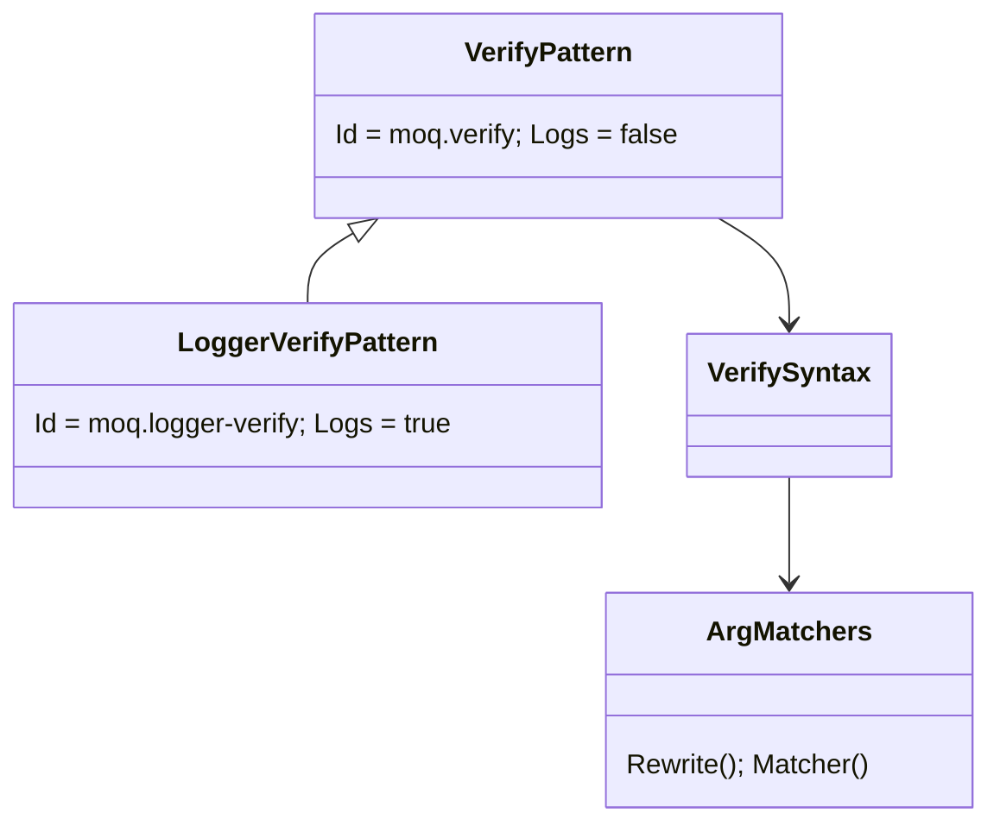
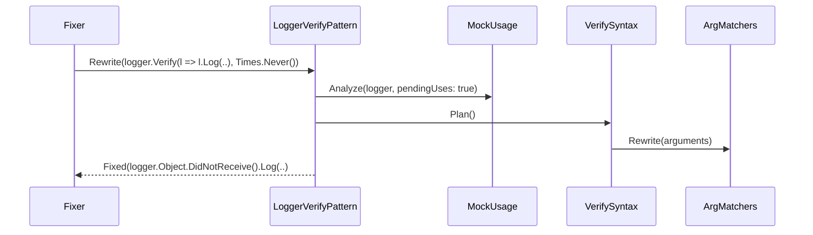

# Models: moq.logger-verify

Facts from `Patterns/LoggerVerifyPattern.cs`, `Patterns/VerifyPattern.cs` and `ArgMatchers.cs`.

**Figure 1.** Classes.

**Figure 2.** Order: before `moq.verify` (which skips `ILogger.Log` verifies) and `moq.create`.

**Figure 3.** Decision tree.

| Question                                          | If no: Manual         | Proof        |
| ------------------------------------------------- | --------------------- | ------------ |
| Whole mock converts?                              | its reason            | -            |
| `Times` has an exact form?                        | `TimesRange`          | (moq.verify) |
| State predicate only calls `ToString()` (or none)? | `MatcherUnsupported`  | `state-cast` |
| Leaf                                              | `Received(n).Log(..)` | `once`, `never`, run-time `logger-pass` |

## See also

- [moq-logger-verify-plan.md](moq-logger-verify-plan.md)
- [moq-logger-verify-verify.md](moq-logger-verify-verify.md)
