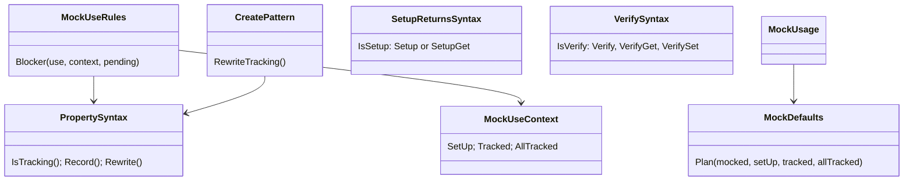

# Models: moq.properties

Facts from `src/Unshackle.Core/Fixes/Moq/PropertySyntax.cs`, `MockUseRules.cs`, `MockDefaults.cs`, `MockCall.RewriteSet`.

**Figure 1.** Where each property API is handled.



**Figure 2.** One Fixer run: the earlier patterns accept the tracking statements as rewritable; `moq.create` removes them in its own pass.

```mermaid
sequenceDiagram
    Fixer->>SetupReturnsPattern: SetupGet → m.Object.P.Returns(v)
    Fixer->>VerifyPattern: VerifySet → m.Object.Received(1).P = v
    Fixer->>CreatePattern: declaration + pins; SetupAllProperties removed; SetupProperty(P, v) → m.P.Returns(v)
```

**Figure 3.** Decision tree for a tracking statement and a settable property.

| Question | If no: Manual | Proof |
| --- | --- | --- |
| Not `SetupSet`? | `PropertySetup` | `Create/setup-set` |
| `SetupProperty` lambda is `x => x.P`, P settable, not an indexer? | `PropertyShape` | - |
| Tracking statements before every other setup/verify? | `PropertyOrder` | `SetupReturns/property-order` |
| Settable property tracked (SetupProperty or SetupAllProperties)? | `DefaultValueDiffers` | `Create/setter` |

## See also

- [moq-properties-plan.md](moq-properties-plan.md)
- [moq-properties-verify.md](moq-properties-verify.md)
