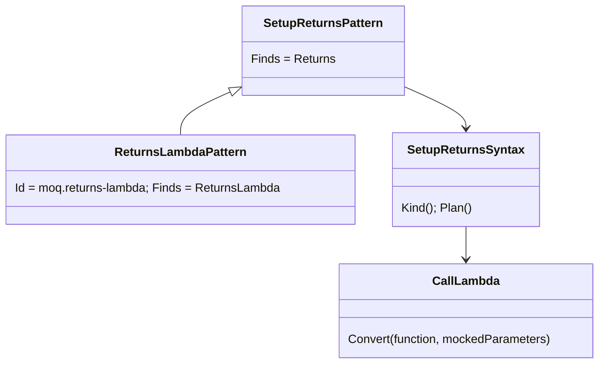
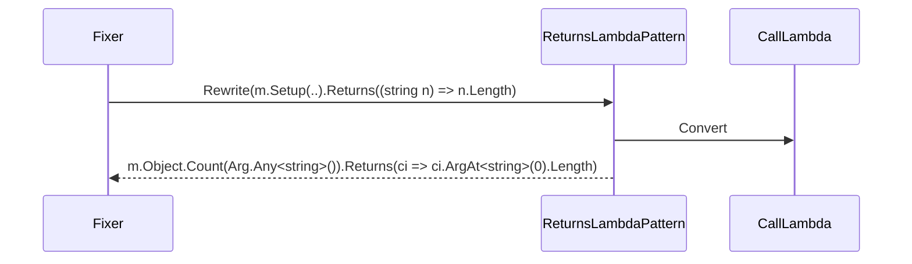

# Models: moq.returns-lambda

Facts from `src/Unshackle.Core/Fixes/Moq/Patterns/ReturnsLambdaPattern.cs`, `CallLambda.cs` and `SetupReturnsSyntax.Plan`.

**Figure 1.** Classes: `ReturnsLambdaPattern` is `SetupReturnsPattern` for `SetupKind.ReturnsLambda`; `CallLambda` converts the function.

**Figure 2.** Order: `moq.verify-all`, `moq.setup-returns`, `moq.returns-lambda`, `moq.throws`, `moq.verify`, `moq.create`.

**Figure 3.** Decision tree.

| Question | If no: Manual `ReturnsLambda` | Proof |
| --- | --- | --- |
| A plain (not async) lambda, not a method group? | yes | `SetupReturns/returns-method-group` |
| No parameters, or as many as the mocked method? | yes | - |
| No parameter assigned, incremented or passed by ref? | yes | `changes-parameter` |
| ReturnsAsync: expression body? | yes | `async-block` |

## See also

- [moq-returns-lambda-plan.md](moq-returns-lambda-plan.md)
- [moq-returns-lambda-verify.md](moq-returns-lambda-verify.md)
