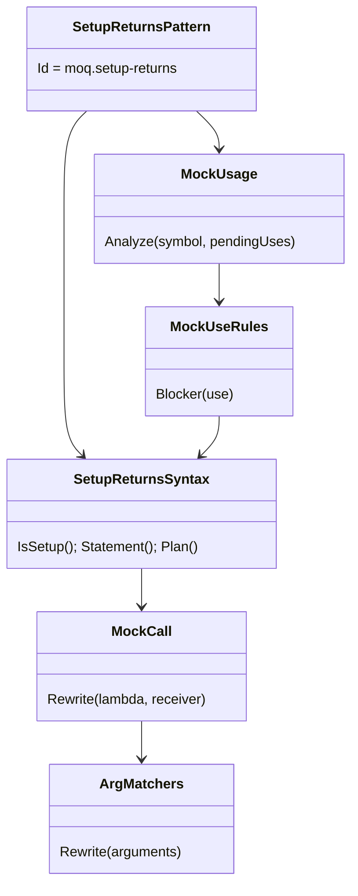

# Models: moq.setup-returns

Facts from `src/Unshackle.Core/Fixes/Moq/Patterns/SetupReturnsPattern.cs` and `SetupReturnsSyntax.cs`.

**Figure 1.** Classes.



**Figure 2.** Sequence in one Fixer run: this pattern first, `moq.create` after it on the changed document.

```mermaid
sequenceDiagram
    Fixer->>SetupReturnsPattern: Find / Rewrite(statement)
    SetupReturnsPattern->>MockUsage: Analyze(m, pendingUses: true)
    MockUsage->>MockUseRules: each use besides .Object
    SetupReturnsPattern-->>Fixer: m.Object.M(Arg..).Returns(v)
    Fixer->>CreatePattern: Find / Rewrite on the new document
    CreatePattern-->>Fixer: var m = Substitute.For<T>(); pins; m.M(..).Returns(v)
```

**Figure 3.** Decision tree.

| Question | If no: Manual | Proof |
| --- | --- | --- |
| Receiver is a local or private field of this file? | `MockPassedAround` | unit (create) |
| Whole mock converts (`MockUsage`)? | its reason (`StrictBehaviour`, `MockUsedBeyondObject`, `DefaultValueDiffers`, ...) | `strict`, `other-use-blocks` |
| Lambda `x => x.M(..)` / `x => x.P` on the mock itself? | `CallShape` | `ArgMatchersTests` |
| Arguments expressible (`ArgMatchers`)? | `MatcherUnsupported`, `MatcherNested`, `MatcherTypeDiffers`, `NamedArgument`, `RefOutOrParams`, `ArgumentUsesMock` | `ArgMatchersTests` |
| `Returns`/`ReturnsAsync` with one value, not a function? | `ReturnsLambda` | `returns-lambda` |

## See also

- [moq-setup-returns-plan.md](moq-setup-returns-plan.md)
- [moq-setup-returns-verify.md](moq-setup-returns-verify.md)
- [moq-create-modellen.md](moq-create-modellen.md)
