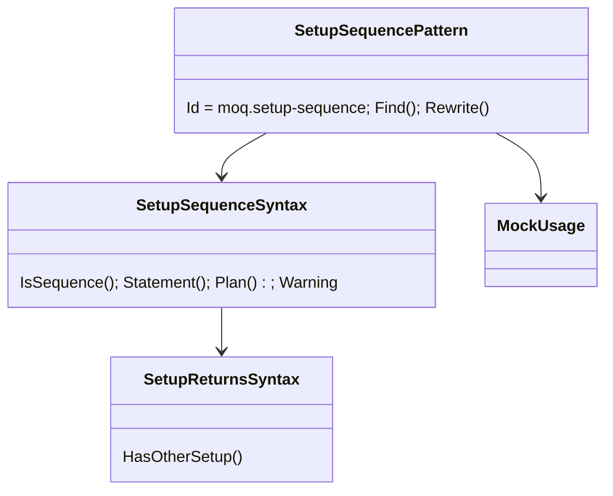

# Models: moq.setup-sequence

Facts from `Patterns/SetupSequencePattern.cs` and `SetupSequenceSyntax.cs`.

**Figure 1.** Classes.



**Figure 2.** Order: after `moq.throws`, before `moq.verify` and `moq.create`.

```mermaid
sequenceDiagram
    Fixer->>SetupSequencePattern: Rewrite(m.SetupSequence(..).Returns(a).Returns(b);)
    SetupSequencePattern->>MockUsage: Analyze(m, pendingUses: true)
    SetupSequencePattern->>SetupSequenceSyntax: Plan()
    SetupSequencePattern-->>Fixer: Fixed(m.Object.M(..).Returns(a, b);) + Warning
```

**Figure 3.** Decision tree.

| Question                                                | If no: Manual                 | Proof                                                                      |
| ------------------------------------------------------- | ----------------------------- | -------------------------------------------------------------------------- |
| Whole mock converts?                                    | its reason                    | -                                                                          |
| Statement with at least one step?                       | `SetupShape`                  | -                                                                          |
| No other setup of the member?                           | `SetupsOverlap`               | `overlap`                                                                  |
| Member has a value (not void)?                          | `SequenceStep`                | `void-member`                                                              |
| Every step `Returns`/`ReturnsAsync` with a plain value? | `SequenceStep`                | `throws-step`, `function-step`                                             |
| Leaf                                                    | `Returns(a, b, ..)` + warning | `returns`, `single`, `property`, `returns-async`, run-time `sequence-pass` |

## See also

- [moq-setup-sequence-plan.md](moq-setup-sequence-plan.md)
- [moq-setup-sequence-verify.md](moq-setup-sequence-verify.md)
