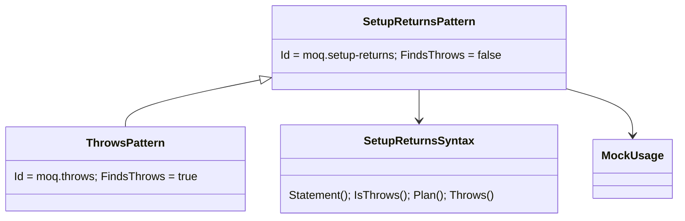

# Models: moq.throws

Facts from `src/Unshackle.Core/Fixes/Moq/Patterns/ThrowsPattern.cs` and `SetupReturnsSyntax.Throws`.

**Figure 1.** Classes: `ThrowsPattern` is `SetupReturnsPattern` that finds the Throws/ThrowsAsync setups (`FindsThrows`); the plan is shared.



**Figure 2.** Order: `moq.verify-all`, `moq.setup-returns`, `moq.throws`, `moq.verify`, `moq.create`.

```mermaid
sequenceDiagram
    Fixer->>ThrowsPattern: Rewrite(m.Setup(..).Throws(ex);)
    ThrowsPattern->>MockUsage: Analyze(m, pendingUses: true)
    ThrowsPattern-->>Fixer: m.Object.M(..).Throws(ex); or m.Object.When(x => x.M(..)).Do(_ => throw ex);
    Fixer->>CreatePattern: .Object dropped
```

**Figure 3.** Decision tree.

| Question | If no: Manual | Proof |
| --- | --- | --- |
| Whole mock converts (`MockUsage`)? | its reason | - |
| `Throws(exception)` or `Throws<E>()` / `ThrowsAsync(exception)`? | `ThrowsShape` | - |
| Member with a value? | void: next row | `throws-value`, `throws-generic`, `throws-async` |
| Void: exception a variable, field or `new E(..)`, not ThrowsAsync? | `ThrowsShape` | `throws-void`, `throws-void-call` |

## See also

- [moq-throws-plan.md](moq-throws-plan.md)
- [moq-throws-verify.md](moq-throws-verify.md)
