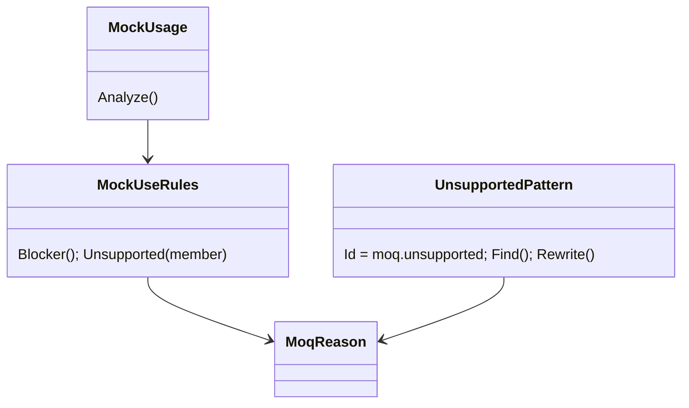
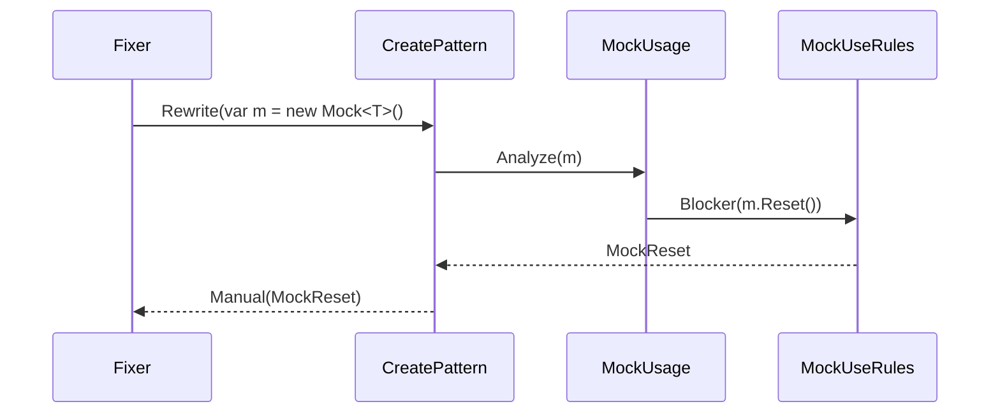

# Models: moq.unsupported

Facts from `Patterns/UnsupportedPattern.cs`, `MockUseRules.cs` and `MockUsage.cs`.

**Figure 1.** Classes.

**Figure 2.** A mock use is found through the mock's creation; its row reports as `moq.unsupported` (council round 13, M8).

**Figure 3.** Decision tree for a use of a mock besides `.Object`.

| Use                          | Code               | Proof                             |
| ---------------------------- | ------------------ | --------------------------------- |
| `Protected()`                | `ProtectedMember`  | `ClassMocks/unsupported-protected` |
| `As<T>()`                    | `MockAs`           | `Create/unsupported-as`           |
| `Invocations`                | `MockInvocations`  | `Create/unsupported-invocations`  |
| `Reset()`                    | `MockReset`        | `Create/unsupported-reset`        |
| `Raise(..)`                  | `MockRaise`        | `Create/unsupported-raise`        |
| `new Mock<T>(MockBehavior.Strict)` | `StrictBehaviour` | `Create/strict`             |
| `new AutoMocker()`           | `AutoMocker`       | `Unsupported/auto-mocker`         |

## See also

- [moq-unsupported-plan.md](moq-unsupported-plan.md)
- [moq-unsupported-verify.md](moq-unsupported-verify.md)
