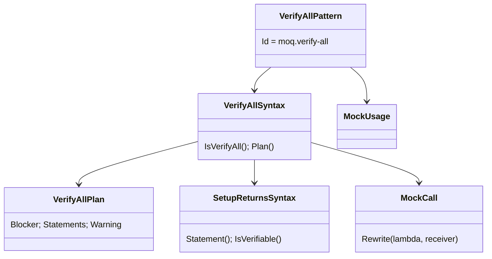

# Models: moq.verify-all

Facts from `src/Unshackle.Core/Fixes/Moq/Patterns/VerifyAllPattern.cs` and `VerifyAllSyntax.cs`.

**Figure 1.** Classes.



**Figure 2.** Order in `MoqFix.Patterns`: `moq.verify-all` (reads `.Verifiable()`), `moq.setup-returns` (drops it, removes void setups),
`moq.verify`, `moq.create`.

```mermaid
sequenceDiagram
    Fixer->>VerifyAllPattern: Rewrite(m.VerifyAll();)
    VerifyAllPattern->>MockUsage: Analyze(m, pendingUses: true)
    VerifyAllPattern-->>Fixer: m.Object.Received().A(..); m.Object.Received().B(..); + warning
    Fixer->>SetupReturnsPattern: setups → m.Object.A(..).Returns(v); void setups removed
    Fixer->>CreatePattern: var m = Substitute.For<T>(); .Object dropped
```

**Figure 3.** Decision tree.

| Question | If no: Manual | Proof |
| --- | --- | --- |
| `Verify()` or `VerifyAll()` (not `VerifyNoOtherCalls`)? | `VerifyNoOtherCalls` | `no-other-calls` |
| Whole mock converts (`MockUsage`)? | its reason | - |
| Mock is a local; Verify a plain statement of a method body? | `VerifyScopeNotLocal` | `field-mock` |
| Every setup a plain statement before it in the same block? | `VerifyScopeNotLocal` | `conditional-setup` |
| No two covered setups on one member? | `SetupsOverlap` | `overlap` |

## See also

- [moq-verify-all-plan.md](moq-verify-all-plan.md)
- [moq-verify-all-verify.md](moq-verify-all-verify.md)
