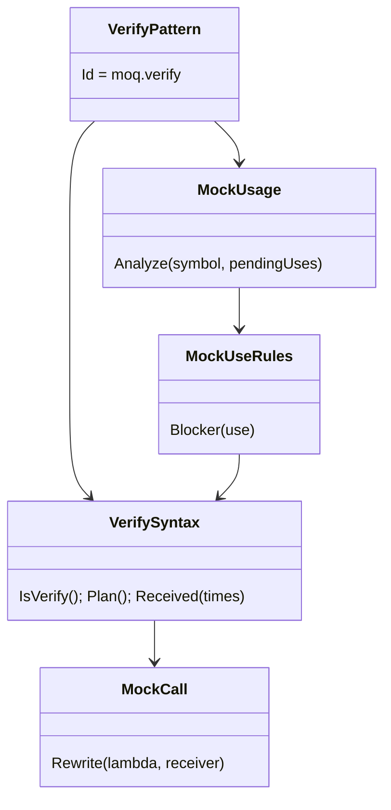
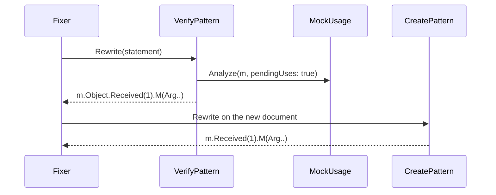

# Models: moq.verify

Facts from `src/Unshackle.Core/Fixes/Moq/Patterns/VerifyPattern.cs` and `VerifySyntax.cs`.

**Figure 1.** Classes.

**Figure 2.** Order in `MoqFix.Patterns`: `moq.setup-returns`, `moq.verify`, then `moq.create`, which sees only `.Object` uses left.

**Figure 3.** Decision tree.

| Question | If no: Manual | Proof |
| --- | --- | --- |
| Receiver is a local or private field of this file? | `MockPassedAround` | - |
| Whole mock converts (`MockUsage`)? | its reason | `verify-all-blocks` |
| No failure message? | `VerifyMessage` | `message` |
| `Times` is Once, Never, Exactly(n), AtLeastOnce or absent? | `TimesRange` | `at-least` |
| Lambda and arguments expressible (`MockCall`, `ArgMatchers`)? | `CallShape`, `Matcher*`, ... | `ArgMatchersTests` |

| Times | NSubstitute | Proofs |
| --- | --- | --- |
| Once | `Received(1)` | `once`, `once-method-group` |
| Never | `DidNotReceive()` | `never`, `property` |
| Exactly(n) | `Received(n)` | `exactly` |
| AtLeastOnce / none | `Received()` | `no-times` |

## See also

- [moq-verify-plan.md](moq-verify-plan.md)
- [moq-verify-verify.md](moq-verify-verify.md)
