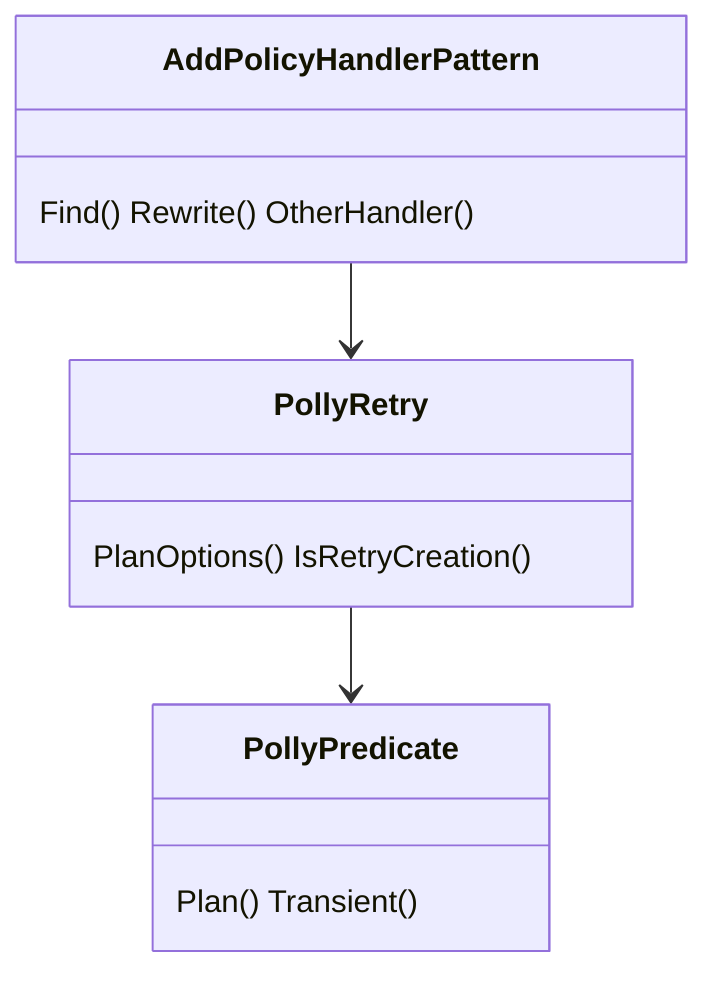
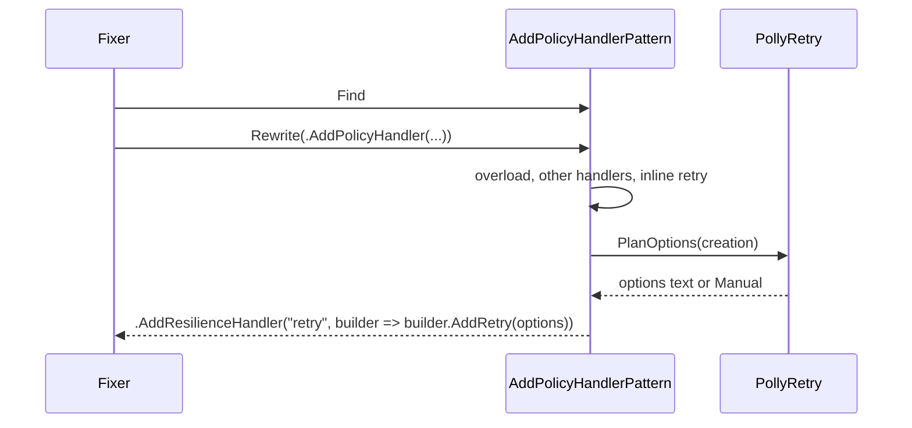
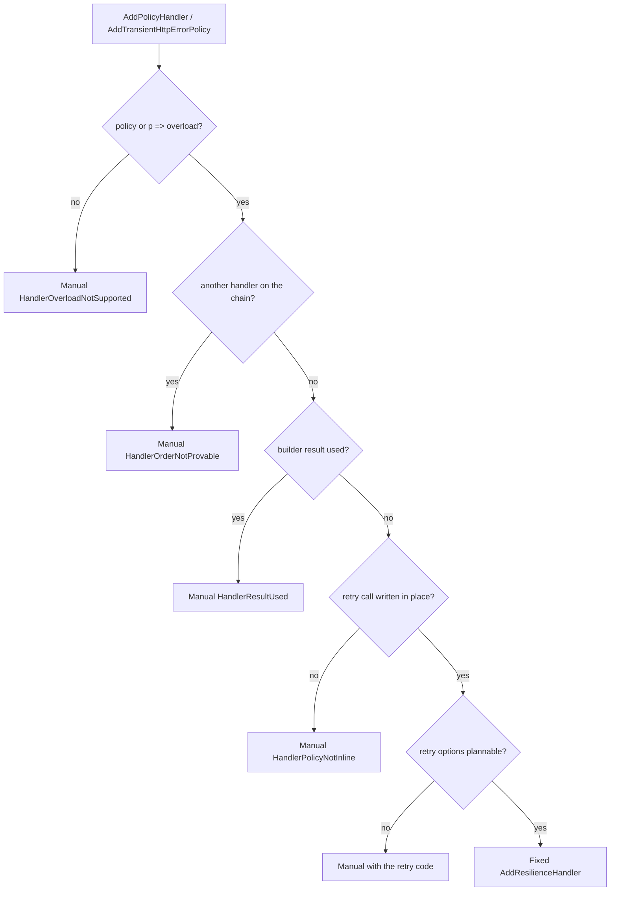

# Models: polly.add-policy-handler

Facts from `src/Unshackle.Core/Fixes/Polly/Patterns/AddPolicyHandlerPattern.cs`, `PollyPredicate.cs` and `PollyRetry.PlanOptions`.

## Figure 1: classes

**Figure 1.** The handler pattern reuses the retry options of the other Polly patterns.

| Element | Role |
| --- | --- |
| `AddPolicyHandlerPattern` | Finds `AddPolicyHandler`/`AddTransientHttpErrorPolicy` of Microsoft.Extensions.Http.Polly |
| `PollyRetry.PlanOptions` | `new RetryStrategyOptions<HttpResponseMessage> { ... }` text, shared with the pipeline patterns |
| `PollyPredicate` | v7 transient filter written out; `p` of the lambda counts as `HandleTransientHttpError()` |

## Figure 2: sequence

**Figure 2.** One node per handler call.

## Figure 3: decision tree

**Figure 3.** Questions asked by `Rewrite`.

| Leaf | Proof |
| --- | --- |
| Fixed | `inline-transient`, `transient-lambda-429` (+ traces) |
| `HandlerOrderNotProvable` | `two-handlers` |
| `HandlerResultUsed` | `result-returned`, unit tests |
| `HandlerPolicyNotInline` | unit tests |
| method inlined and removed | `policy-method` |
| `HandlerOverloadNotSupported`, retry codes | `AddPolicyHandlerPatternTests` |

## See also

- [polly-add-policy-handler-plan.md](polly-add-policy-handler-plan.md)
- [polly-add-policy-handler-verify.md](polly-add-policy-handler-verify.md)
