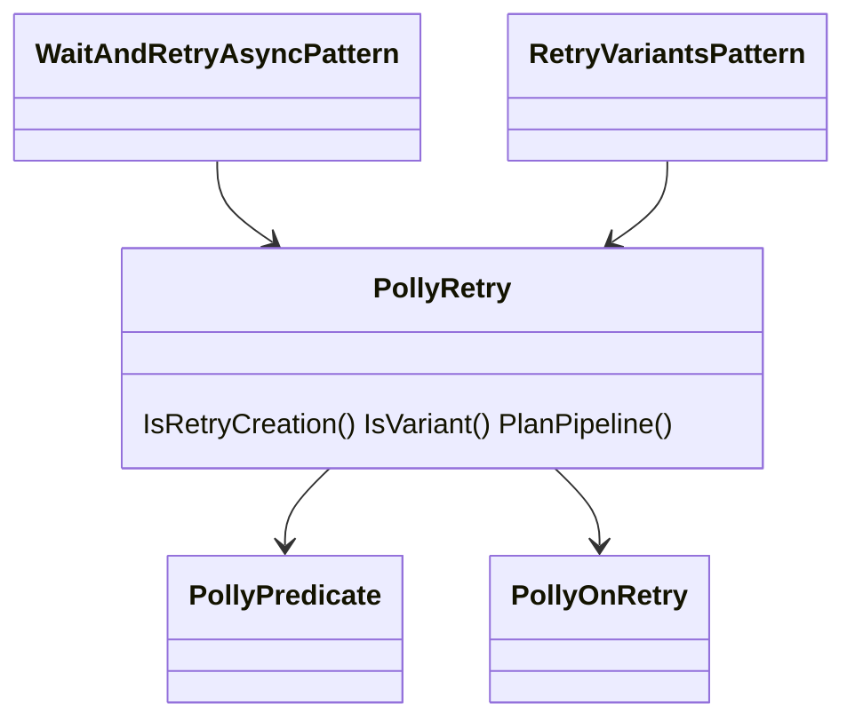
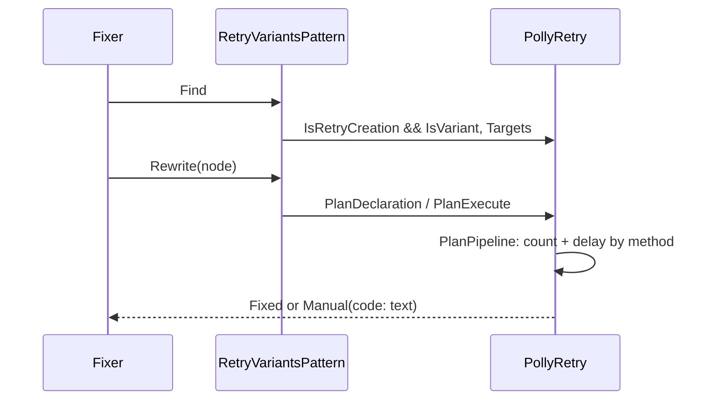
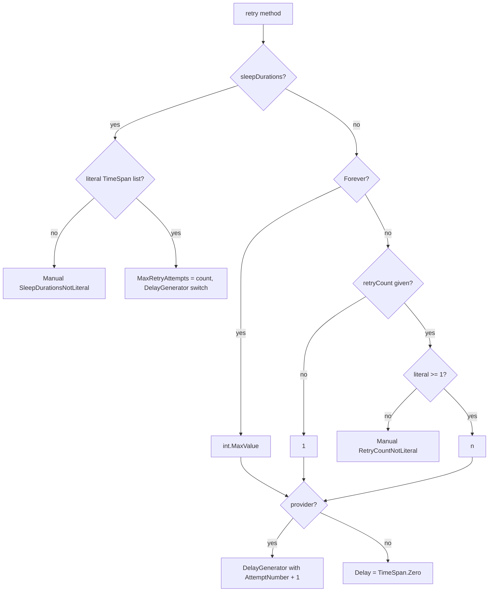

# Models: polly.retry-variants

Facts from `src/Unshackle.Core/Fixes/Polly/Patterns/RetryVariantsPattern.cs` and `src/Unshackle.Core/Fixes/Polly/PollyRetry.cs`.

## Figure 1: classes

**Figure 1.** Two patterns share one analysis; `IsVariant` splits the retry calls between them.

| Element | Role |
| --- | --- |
| `RetryVariantsPattern` | Finds retry calls with `IsVariant` true |
| `PollyRetry.IsVariant` | not `WaitAndRetryAsync`, or `WaitAndRetryAsync` with a `sleepDurations` parameter |
| `PollyRetry.PlanPipeline` | `MaxRetryAttempts` and delay lines per method; filter and onRetry shared |

## Figure 2: sequence

**Figure 2.** Same as `polly.wait-and-retry-async` (Find → Targets; Rewrite → PlanDeclaration / PlanExecute → PlanPipeline);
only the `MaxRetryAttempts`/delay step differs.

## Figure 3: decision tree

**Figure 3.** The method-specific part of `PlanPipeline`.

| Leaf | Proof |
| --- | --- |
| list | `durations`, `durations-variable` |
| Forever | `wait-forever` |
| count / default | `retry-count`, `retry-default` |

## See also

- [polly-retry-variants-plan.md](polly-retry-variants-plan.md)
- [polly-retry-variants-verify.md](polly-retry-variants-verify.md)
- [polly-wait-and-retry-async-modellen.md](polly-wait-and-retry-async-modellen.md)
