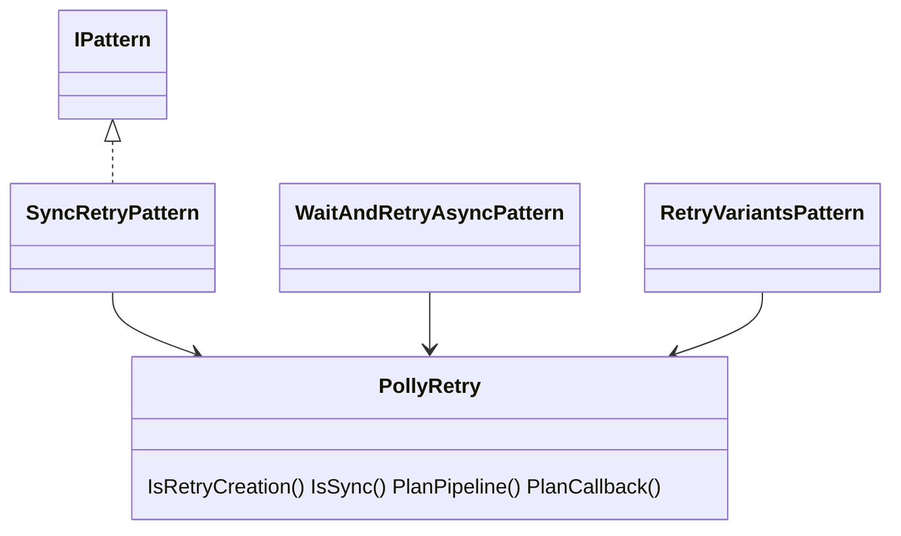
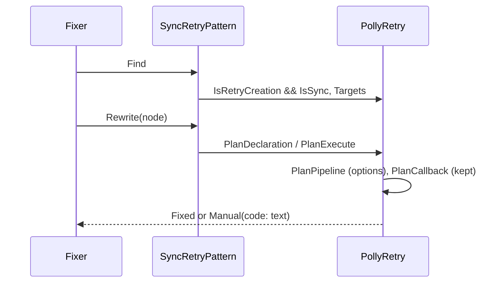
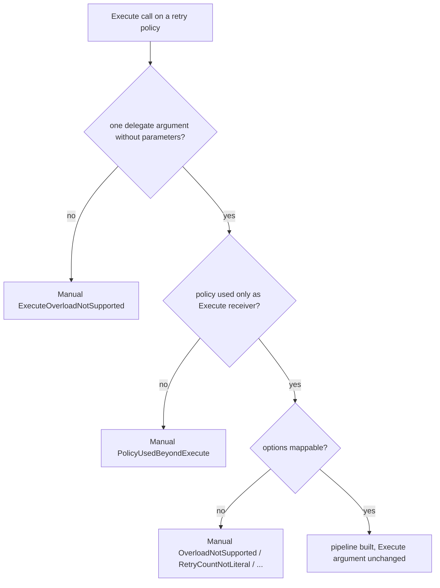

# Models: polly.sync-retry

Facts from `src/Unshackle.Core/Fixes/Polly/Patterns/SyncRetryPattern.cs` and `src/Unshackle.Core/Fixes/Polly/PollyRetry.cs`.

## Figure 1: classes

**Figure 1.** The pattern shares `PollyRetry` with the async patterns; `IsSync` splits the retry calls between them.

| Element | Role |
| --- | --- |
| `SyncRetryPattern` | Finds retry calls whose method name does not end in `Async` |
| `PollyRetry.IsSync` | The split: the two async patterns skip these calls |
| `PollyRetry.PlanCallback` | `Execute(Action)` / `Execute<T>(Func<T>)`: the argument is kept |

## Figure 2: sequence

**Figure 2.** Same flow as `polly.wait-and-retry-async`; `ExecuteOn` also matches `Execute`.

## Figure 3: decision tree

**Figure 3.** The `Execute` part of the decision; the options part is shared with the async patterns.

| Leaf | Proof |
| --- | --- |
| pipeline, Execute kept | `wait-and-retry`, `retry-on-retry`, `handle-result`, `forever` |
| `ExecuteOverloadNotSupported` | `context` |
| `PolicyUsedBeyondExecute` | `policy-used-beyond` |

## See also

- [polly-sync-retry-plan.md](polly-sync-retry-plan.md)
- [polly-sync-retry-verify.md](polly-sync-retry-verify.md)
- [polly-wait-and-retry-async-modellen.md](polly-wait-and-retry-async-modellen.md)
