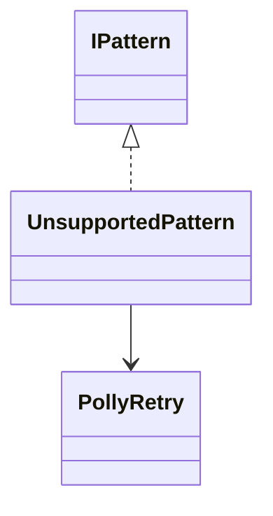
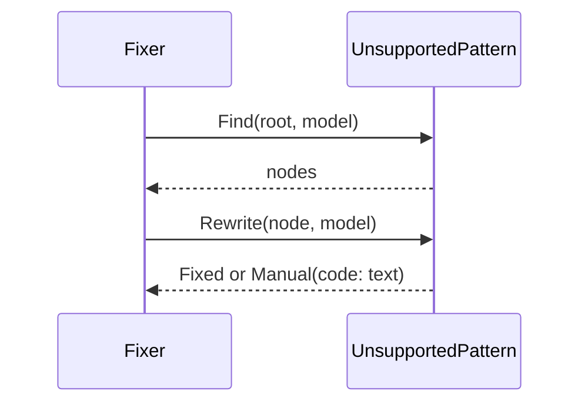
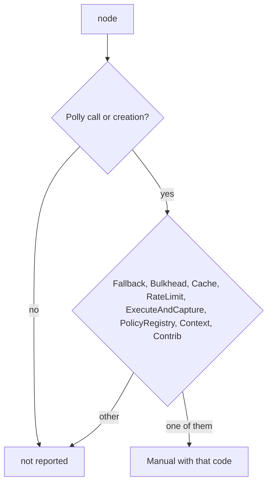

# Models: polly.unsupported

Facts from `src/Unshackle.Core/Fixes/Polly/Patterns/UnsupportedPattern.cs` and `src/Unshackle.Core/Fixes/Polly/PollyRetry.cs`.

## Figure 1: classes

**Figure 1.** The pattern and the helpers it uses.

| Element | Role |
| --- | --- |
| `UnsupportedPattern` | `Find` selects the nodes, `Rewrite` returns `Fixed` or `Manual(code, reason)` |
| `PollyRetry` | Shared holder, Execute and name analysis (`IsTimeout`, `IsNoOp`, `Targets`, `PlanDeclaration`, `PlanExecute`) |

## Figure 2: sequence

**Figure 2.** The flow the Fixer drives.

## Figure 3: decision tree

**Figure 3.** What `Rewrite` asks.

| Leaf | Proof |
| --- | --- |
| Manual `<Kind>NotMapped` | `fallback`, `bulkhead`, `rate-limit`, `registry`, `context`, `execute-and-capture` |

## See also

- [polly-unsupported-plan.md](polly-unsupported-plan.md)
- [polly-unsupported-verify.md](polly-unsupported-verify.md)
- [polly-sync-retry-modellen.md](polly-sync-retry-modellen.md)
