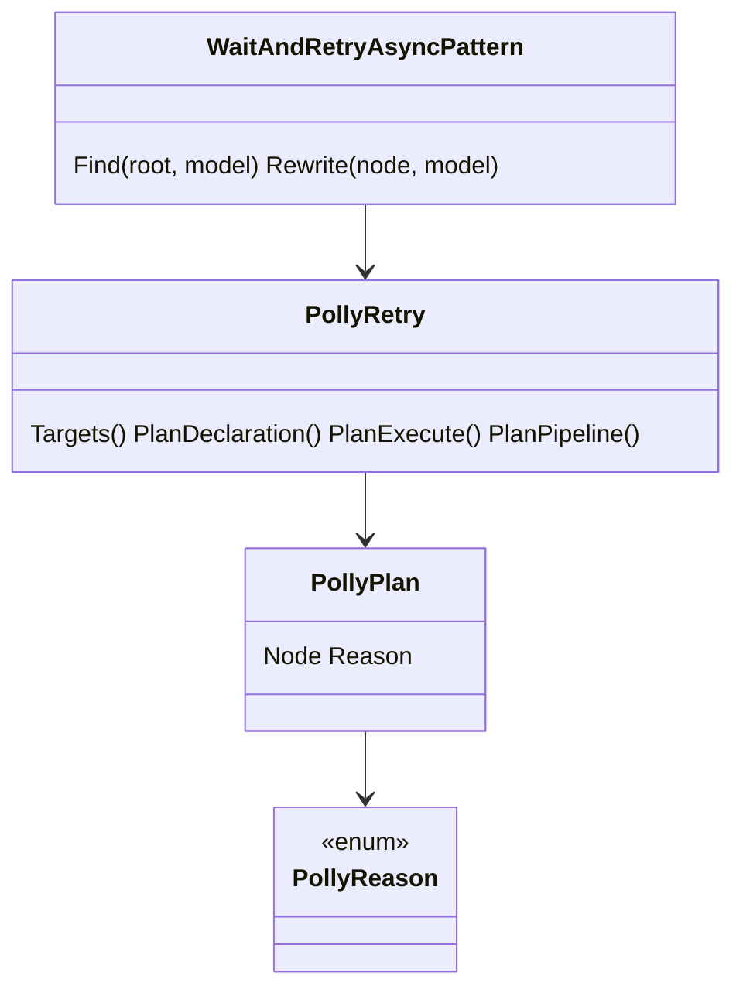
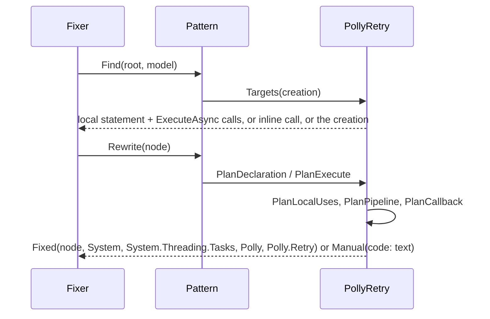
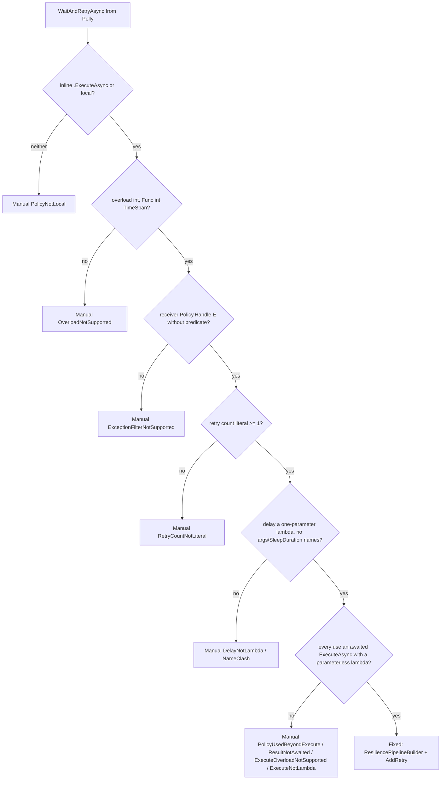

# Models: polly.wait-and-retry-async

Facts from `src/Unshackle.Core/Fixes/Polly/Patterns/WaitAndRetryAsyncPattern.cs` and `src/Unshackle.Core/Fixes/Polly/PollyRetry.cs`.

## Figure 1: classes

**Figure 1.** The pattern, its analysis helper and the v7/v8 types.

| Element | Role |
| --- | --- |
| `WaitAndRetryAsyncPattern` | Finds `WaitAndRetryAsync` from assembly `Polly`; maps a `PollyPlan` to `Fixed`/`Manual` |
| `PollyRetry` | Shape analysis from the original tree; declaration and calls of one local share every check |
| `PollyReason` | Typed reason code that leads every Manual text |
| Polly v7 | `AsyncRetryPolicy`, `ExecuteAsync(Func<Task>)` → `Task` |
| Polly.Core 8 | `ResiliencePipeline`, `ExecuteAsync(Func<CancellationToken, ValueTask>)` → `ValueTask` |

## Figure 2: sequence

**Figure 2.** From the Fixer via `Find` and `Rewrite`.

| Step | Method | What happens |
| --- | --- | --- |
| Find | `IsWaitAndRetryAsync`, `Targets` | outer nodes only, so replacements never nest |
| Uses | `PlanLocalUses` | every reference of the local must be an awaited rewritable `ExecuteAsync` |
| Pipeline | `PlanPipeline` | builder text at the statement's indentation; delay body re-indented into `SleepDuration` |
| Callback | `PlanCallback` | `async _ =>` or `_ => new ValueTask(<T>)(expr)` |

## Figure 3: decision tree

**Figure 3.** Questions asked by `Rewrite`.

| Leaf | Proof |
| --- | --- |
| Fixed | `local-block-delay`, `inline-result`, `typed-local-not-handled` (+ behaviour traces) |
| `PolicyNotLocal` | `policy-returned` |
| `OverloadNotSupported` | unit test (Context-taking provider) |
| onRetry Fixed / `OnRetryUsesContext` | `on-retry-attempt`, `on-retry-async`, `on-retry-result` / `on-retry-context` |
| `RetryCountNotLiteral` | `retry-count-variable` |
| `ResultNotAwaited` | `result-not-awaited` |
| other codes | `WaitAndRetryAsyncPatternTests.Rewrite_UnsupportedShape_EveryFindingManualWithCode` |

## See also

- [polly-wait-and-retry-async-plan.md](polly-wait-and-retry-async-plan.md)
- [polly-wait-and-retry-async-verify.md](polly-wait-and-retry-async-verify.md)
