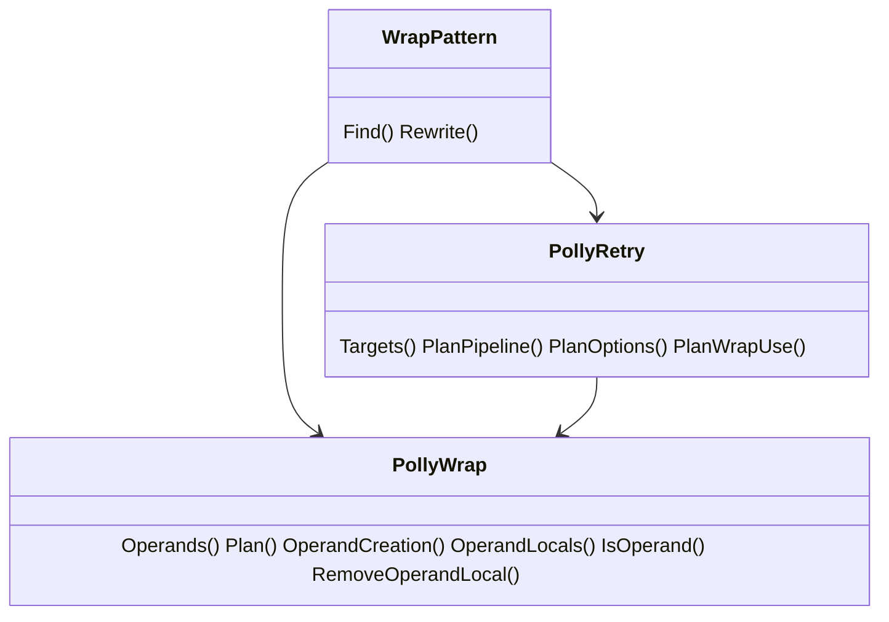
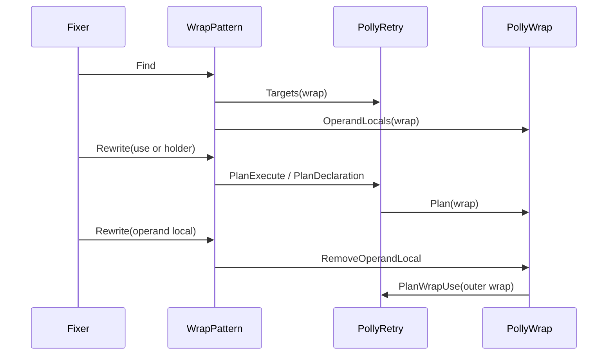
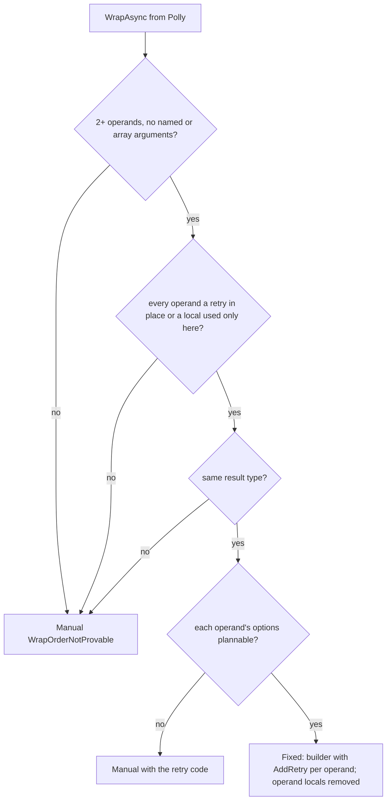

# Models: polly.wrap

Facts from `src/Unshackle.Core/Fixes/Polly/Patterns/WrapPattern.cs` and `src/Unshackle.Core/Fixes/Polly/PollyWrap.cs`.

## Figure 1: classes

**Figure 1.** The wrap reuses the holder machinery and the retry options.

| Element | Role |
| --- | --- |
| `PollyWrap.Operands` | operands outermost first; nested wraps flattened |
| `PollyWrap.Plan` | one `AddRetry(PlanOptions(operand))` per operand |
| `PollyWrap.IsOperand` | tells the retry patterns to leave an operand alone |
| `PollyRetry.PlanWrapUse` | the wrap's own plan, which decides whether operand locals go |

## Figure 2: sequence

**Figure 2.** One outermost wrap, its use and its operand locals.

## Figure 3: decision tree

**Figure 3.** Questions asked for a wrap.

| Leaf | Proof |
| --- | --- |
| Fixed, arity 2 | `two-locals` (+ trace, reversal differs) |
| Fixed, arity 3 | `three-inline` (+ trace, reversal differs) |
| `WrapOrderNotProvable` | `operand-reused` |

## See also

- [polly-wrap-plan.md](polly-wrap-plan.md)
- [polly-wrap-verify.md](polly-wrap-verify.md)
