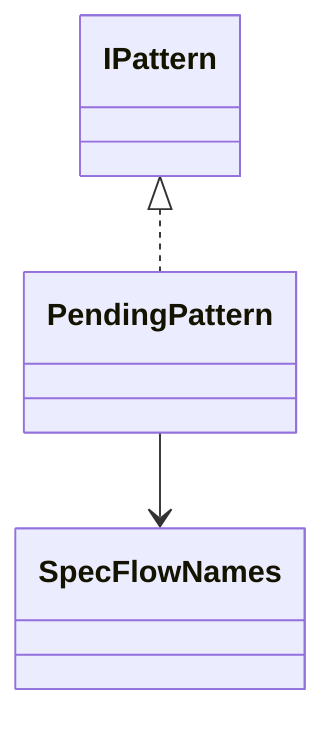
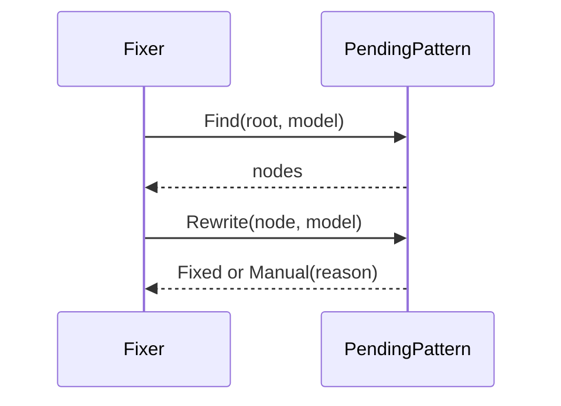
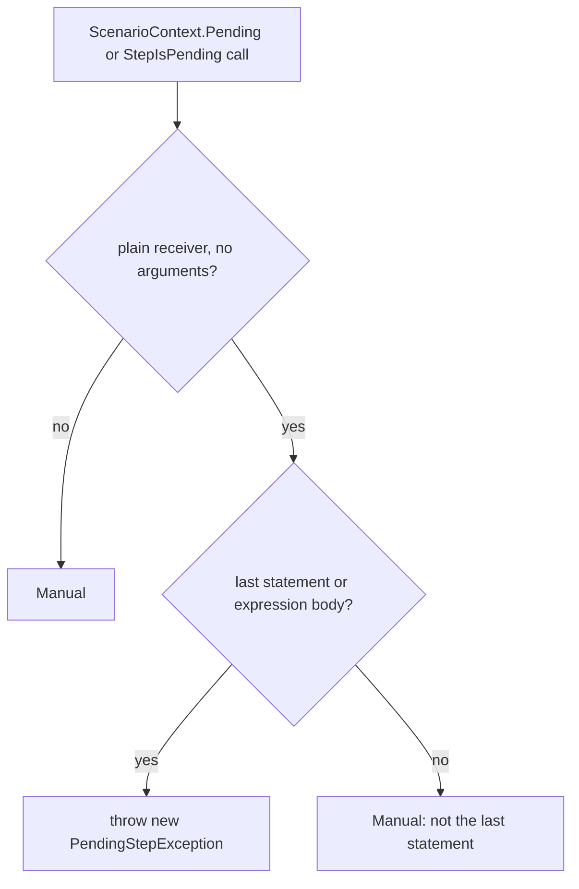

# Models: specflow.pending

Facts from `src/Unshackle.Core/Fixes/SpecFlow/Patterns/PendingPattern.cs` and `src/Unshackle.Core/Fixes/SpecFlow/SpecFlowNames.cs`.

## Figure 1: classes

**Figure 1.** The pattern and the name map it uses.

| Element | Role |
| --- | --- |
| `PendingPattern` | `Find` selects the nodes, `Rewrite` returns `Fixed` or `Manual(reason)` |
| `SpecFlowNames` | Namespace swap, rename table and removed types of SpecFlow 3.9.74 → Reqnroll 3.3.4 |

## Figure 2: sequence

**Figure 2.** The flow the Fixer drives.

## Figure 3: decision tree

**Figure 3.** What `Rewrite` asks.

| Leaf | Proof |
| --- | --- |
| Fixed | skeleton |
| Manual | not-last |

## See also

- [specflow-pending-plan.md](specflow-pending-plan.md)
- [specflow-pending-verify.md](specflow-pending-verify.md)
