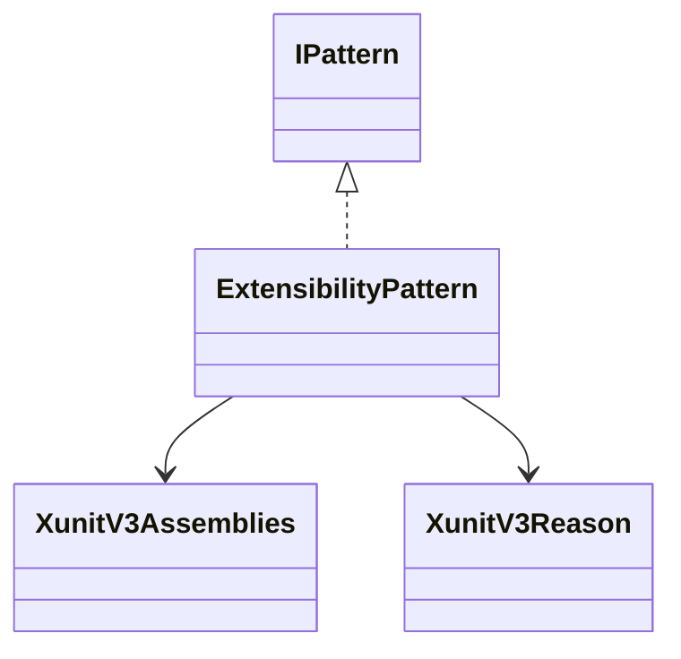
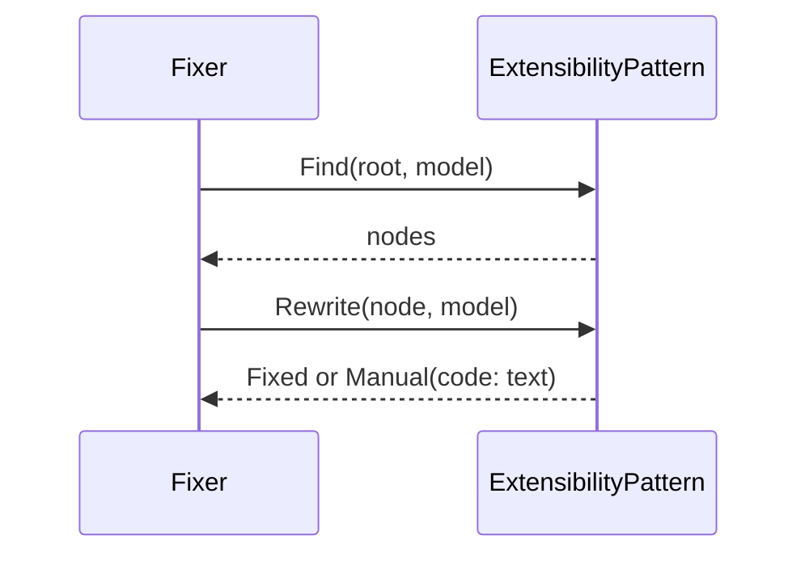
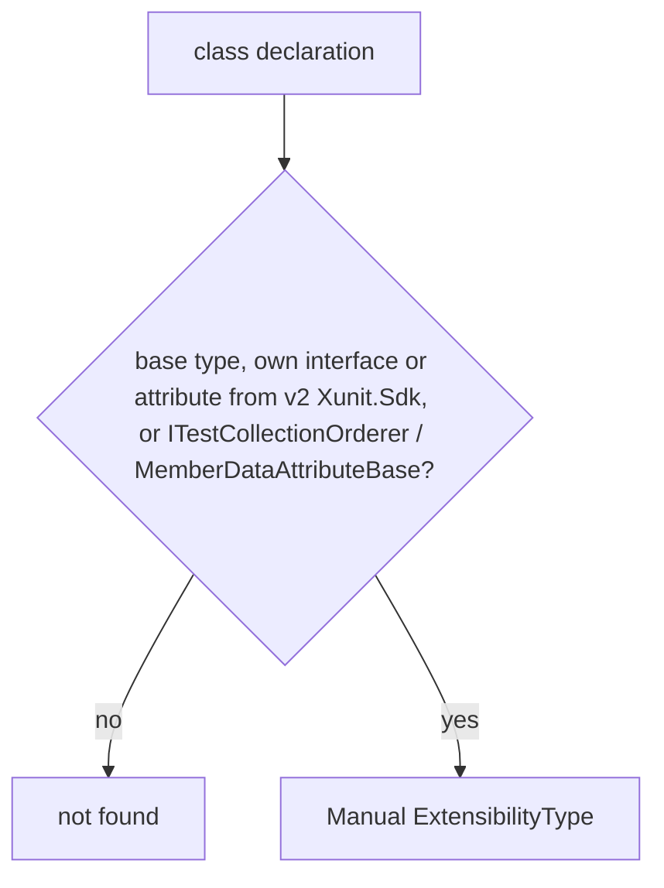

# Models: xunit3.extensibility

Facts from `src/Unshackle.Core/Fixes/XunitV3/Patterns/ExtensibilityPattern.cs`.

## Figure 1: classes

**Figure 1.** The pattern and the helpers it uses.

| Element | Role |
| --- | --- |
| `ExtensibilityPattern` | `Find` selects the nodes, `Rewrite` returns `Fixed` or `Manual(code, reason)` |
| `XunitV3Assemblies` | Names of the v2 assemblies; `IsFrom` checks a symbol's assembly |
| `XunitV3Reason` | Typed reason codes of the Manual rows |

## Figure 2: sequence

**Figure 2.** The flow the Fixer drives.

## Figure 3: decision tree

**Figure 3.** What `Find` and `Rewrite` ask.

| Leaf | Proof |
| --- | --- |
| Manual `ExtensibilityType` | `custom-types` |

## See also

- [xunit3-extensibility-plan.md](xunit3-extensibility-plan.md)
- [xunit3-extensibility-verify.md](xunit3-extensibility-verify.md)
