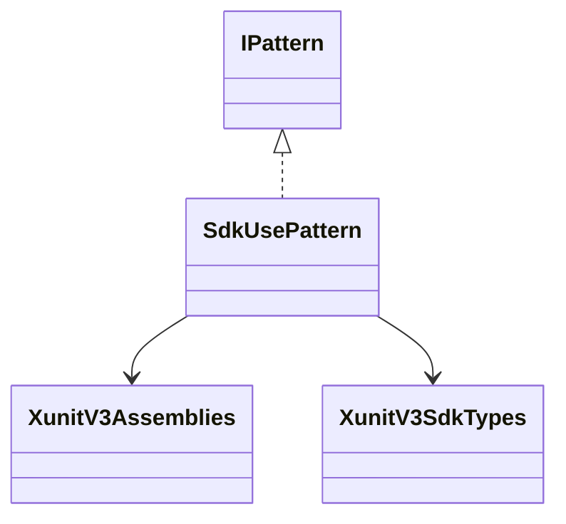
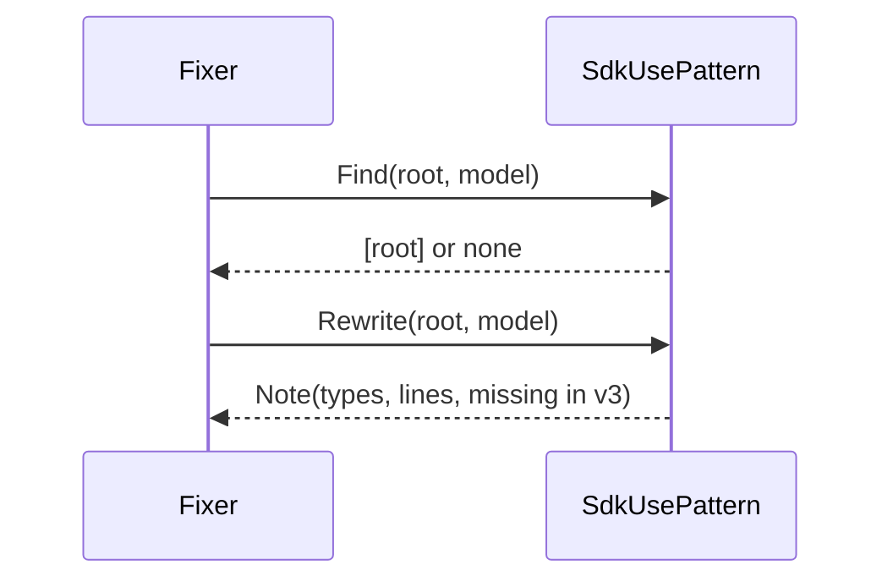
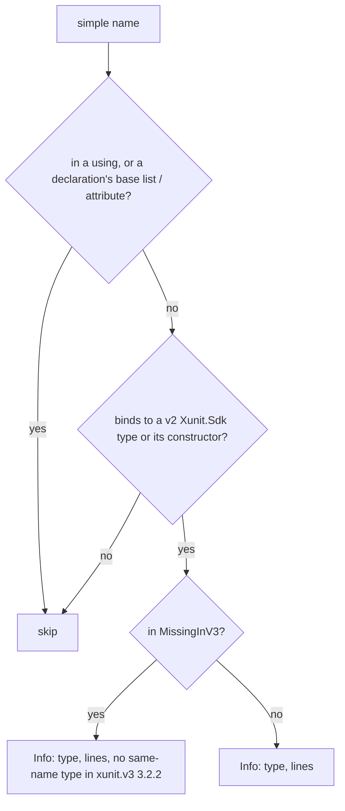

# Models: xunit3.sdk-use

Facts from `src/Unshackle.Core/Fixes/XunitV3/Patterns/SdkUsePattern.cs`.

## Figure 1: classes

**Figure 1.** The pattern and the helpers it uses.

| Element | Role |
| --- | --- |
| `SdkUsePattern` | `Find` returns the root when the file uses a v2 `Xunit.Sdk` type; `Rewrite` returns one Info note |
| `XunitV3Assemblies` | Names of the v2 assemblies |
| `XunitV3SdkTypes` | `MissingInV3`: v2 `Xunit.Sdk` types without a same-name v3 type (checked by a test against the real assemblies) |

## Figure 2: sequence

**Figure 2.** The flow the Fixer drives.

## Figure 3: decision tree

**Figure 3.** What `Find` and `Rewrite` ask per name.

| Leaf | Proof |
| --- | --- |
| Info with "no same-name type" | `changed-members` (`RunSummary`) |
| Info without | `changed-members` (`TestTimeoutException`) |

## See also

- [xunit3-sdk-use-plan.md](xunit3-sdk-use-plan.md)
- [xunit3-sdk-use-verify.md](xunit3-sdk-use-verify.md)
